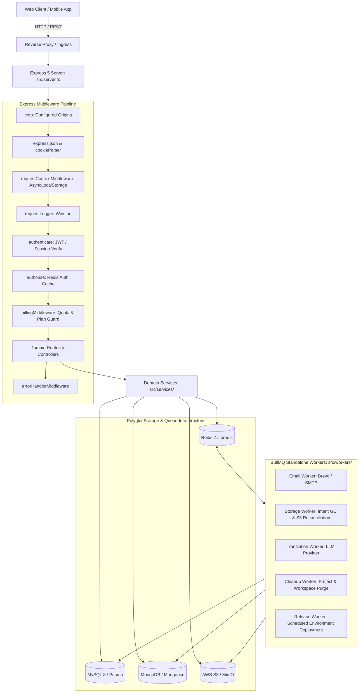
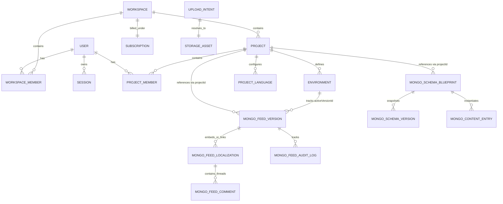
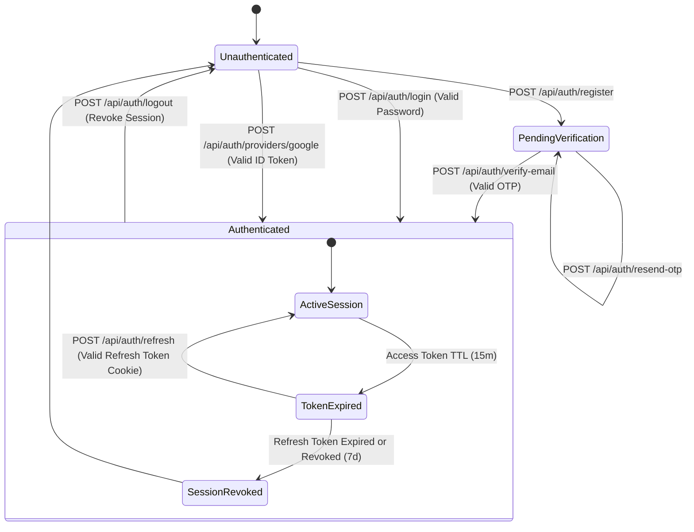
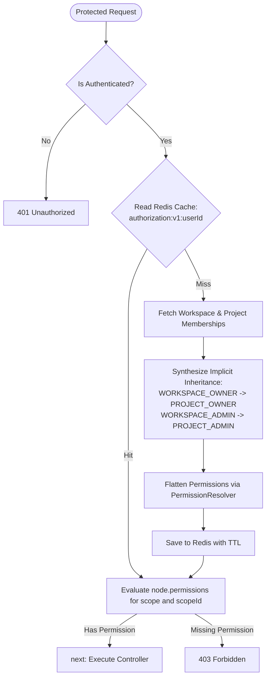
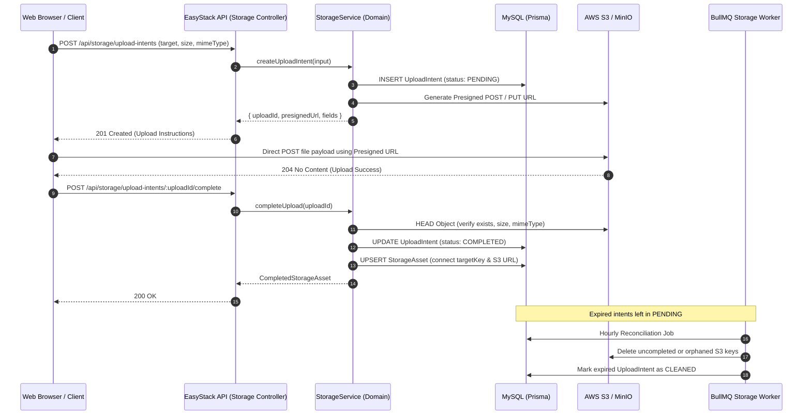

# Master Architecture & Flow Diagrams

This document collects architectural and data flow Mermaid diagrams modeling the runtime topology, polyglot storage relationships, and lifecycle mechanics of EasyStack Backend.

---

## 1. System Runtime Topology

---

## 2. Polyglot Entity-Relationship Architecture

---

## 3. Authentication & Token Rotation State Machine

---

## 4. Authorization Resolution Flow

---

## 5. Intent-Based Object Storage Upload Flow

