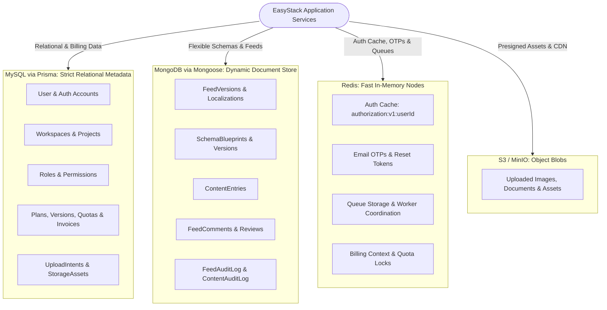

# Polyglot Persistence Architecture

## 1. Rationale & Storage Separation

EasyStack operates on a **Polyglot Persistence** model. Rather than forcing all application concerns into a single database engine, the backend partitions data across four storage technologies according to data structure, access patterns, and consistency guarantees:

---

## 2. Store Responsibilities

### A. MySQL (Managed via Prisma ORM)
- **Primary Source of Truth** for tenant boundaries, organizational hierarchies, authentication records, and billing contracts.
- **Why MySQL?** Requires strict ACID transaction semantics, foreign key cascades, unique constraints, and referential integrity across tenants, projects, and subscription tiers.
- **Core Entities**:
  - `User`, `AuthAccount`, `Session`, `RefreshToken`
  - `Workspace`, `WorkspaceMember`, `Project`, `ProjectMember`, `Environment`, `ProjectLanguage`
  - `Role`, `Permission`, `RolePermission`
  - `Plan`, `PlanVersion`, `PlanPricing`, `PlanFeature`, `PlanQuota`, `Subscription`, `SubscriptionHistory`, `Payment`, `Invoice`
  - `UploadIntent`, `StorageAsset`

### B. MongoDB (Managed via Mongoose)
- **Document Store** for user-authored dynamic content, schema blueprints, localized feeds, review comments, and event audit trails.
- **Why MongoDB?** User-defined JSON structures vary dynamically per project. MongoDB handles deeply nested JSON trees, versioned document snapshots, and high-frequency audit appending without requiring SQL schema migrations for every content structure change.
- **Core Collections / Models**:
  - `SchemaBlueprint`, `SchemaBlueprintVersion` ([`src/models/schema-blueprint.model.ts`](file:///home/eteknas/Projects/easystack-backend/src/models/schema-blueprint.model.ts))
  - `ContentEntry`, `ContentAuditLog` ([`src/models/content-entry.model.ts`](file:///home/eteknas/Projects/easystack-backend/src/models/content-entry.model.ts))
  - `FeedVersion`, `FeedLocalization` ([`src/models/feed-version.model.ts`](file:///home/eteknas/Projects/easystack-backend/src/models/feed-version.model.ts), [`src/models/feed-localization.model.ts`](file:///home/eteknas/Projects/easystack-backend/src/models/feed-localization.model.ts))
  - `FeedComment` ([`src/models/feed-comment.model.ts`](file:///home/eteknas/Projects/easystack-backend/src/models/feed-comment.model.ts))
  - `FeedAuditLog`, `ProjectLanguageAuditLog` ([`src/models/feed-audit-log.model.ts`](file:///home/eteknas/Projects/easystack-backend/src/models/feed-audit-log.model.ts))

### C. Redis (Managed via `ioredis` & BullMQ)
- **High-Performance In-Memory Store** for low-latency middleware gates, ephemeral credentials, and background task queuing.
- **Why Redis?** Sub-millisecond lookup speeds prevent database bottlenecks during route authorization and request rate limiting.
- **Key Categories**:
  - `authorization:v1:<userId>`: Flattened JSON authorization cache containing all active workspace and project permissions.
  - `email_otp:<userId>`: Hashed 6-digit OTP codes with TTLs.
  - `email_verification:<token>`: Temporary verification record mapping tokens to user IDs.
  - `password_reset:<token>`: Hashed password reset tokens.
  - `billing:context:<workspaceId>`: Cached subscription limits and quota balances.
  - `bull:*`: BullMQ internal keys for queues, delayed jobs, and repeatable schedules.

### D. Object Storage (AWS S3 / MinIO)
- **Blob Storage** for user avatars, project assets, media files, and attachments.
- **Why S3?** Keeps binary blobs outside both MySQL and MongoDB, offloading file uploads directly from the browser via presigned POST requests.
- **Config & Infrastructure**:
  - Centralized settings in [`src/config/storage.ts`](file:///home/eteknas/Projects/easystack-backend/src/config/storage.ts).
  - Local emulation via MinIO in [`infra/storage/docker-compose.yml`](file:///home/eteknas/Projects/easystack-backend/infra/storage/docker-compose.yml).

---

## 3. Cross-Store Coordination & Consistency

Because an entity's metadata lives in MySQL while its content documents live in MongoDB and files live in S3, the application coordinates operations across store boundaries:

### 1. Dual-Write & Transaction Coordination
- MySQL operations use Prisma interactive transactions (`prisma.$transaction(async tx => { ... })`).
- When a workflow updates both MySQL (e.g., creating an `EnvironmentState` or `Release`) and MongoDB (e.g., cloning a `FeedVersion`), the service:
  1. Writes the MongoDB document first or verifies its schema.
  2. Executes the MySQL transaction linking to the MongoDB `_id` string.
  3. If the MySQL transaction aborts, compensation logic removes or marks the orphaned MongoDB document.

### 2. Cascading Cleanups on Deletion
When a project or workspace is soft-deleted or removed:
- MySQL marks `removedAt: new Date()` for the workspace, projects, and members.
- The service calls [`cleanupProjectExternalData`](file:///home/eteknas/Projects/easystack-backend/src/services/cleanup.service.ts) or enqueues a `cleanup` job in BullMQ ([`src/services/cleanup/infrastructure/queue/cleanup.worker.ts`](file:///home/eteknas/Projects/easystack-backend/src/services/cleanup/infrastructure/queue/cleanup.worker.ts)).
- The cleanup routine deletes:
  - MongoDB `FeedVersion`, `FeedLocalization`, `FeedComment`, and `FeedAuditLog` documents associated with the feed and project.
  - S3 object blobs associated with the project's `StorageAsset` records.

### 3. Cache Invalidation
Whenever any relational record affecting permissions (such as workspace role or project assignment) changes:
- The database update completes.
- [`AuthorizationCacheService.evict(userId)`](file:///home/eteknas/Projects/easystack-backend/src/services/authorization/cache/cache.service.ts) immediately deletes `authorization:v1:<userId>` from Redis.
- The next incoming HTTP request automatically triggers a cache rebuild from MySQL.
