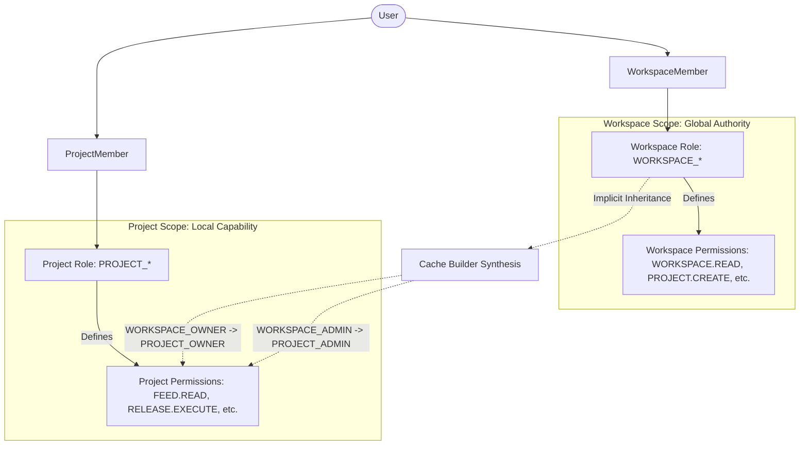
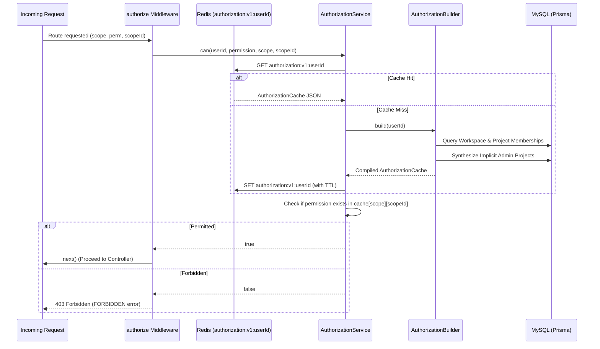

# Role-Based Access Control (RBAC) & Security Architecture

## 1. Overview & Dual-Scope Hierarchy

EasyStack implements a high-performance, two-tiered RBAC engine designed to enforce authorization at the **Workspace** (tenant) and **Project** (resource) scopes.

Authorization is checked at the API layer via the `authorize` middleware, which validates permissions against a pre-compiled, flattened Redis cache (`authorization:v1:<userId>`).



---

## 2. Roles & Permission Definitions

All permissions and roles are defined strictly in code under [`src/services/authorization/configs/`](file:///home/eteknas/Projects/easystack-backend/src/services/authorization/configs).

### A. Workspace Roles
Defined in [`src/services/authorization/configs/workspace-roles.config.ts`](file:///home/eteknas/Projects/easystack-backend/src/services/authorization/configs/workspace-roles.config.ts):

| Role Key | Name | Capabilities | Key Permissions |
|---|---|---|---|
| `WORKSPACE_OWNER` | Owner | Full authority over the entire workspace and all nested projects. | `WORKSPACE_ALL`, `PROJECT_ALL` |
| `WORKSPACE_ADMIN` | Admin | Administrative authority over members, invites, and settings. Automatically inherits project admin rights. | `WORKSPACE.READ`, `UPDATE`, `INVITE`, `MANAGE_MEMBERS`, `PROJECT_ADMIN_ALL` |
| `WORKSPACE_MEMBER` | Member | Standard member capable of creating projects and accessing assigned projects. | `WORKSPACE.READ`, `PROJECT.CREATE` |
| `WORKSPACE_VIEWER` | Viewer | Read-only access to workspace metadata. | `WORKSPACE.READ` |
| `WORKSPACE_GUEST` | Guest | Restricted guest invited only to specific projects; cannot see general workspace members or other projects. | `WORKSPACE.READ` |

### B. Project Roles
Defined in [`src/services/authorization/configs/project-roles.config.ts`](file:///home/eteknas/Projects/easystack-backend/src/services/authorization/configs/project-roles.config.ts):

| Role Key | Name | Capabilities | Key Permissions |
|---|---|---|---|
| `PROJECT_OWNER` | Owner | Complete control over project configuration, environments, and members. | `PROJECT_ALL` |
| `PROJECT_ADMIN` | Admin | Administrative authority over project resources and member assignments. | `PROJECT_ADMIN_ALL` |
| `PROJECT_EDITOR` | Editor | Authors content, edits schemas, and manages draft feeds. | `PROJECT_EDITOR_ALL` |
| `PROJECT_CONTRIBUTOR` | Contributor | Edits translations and localized feeds, but cannot modify core schemas or project settings. | `PROJECT_CONTRIBUTOR_ALL` |
| `PROJECT_VIEWER` | Viewer | Read-only viewing of project feeds, schemas, and releases. | `PROJECT_VIEWER_ALL` |

---

## 3. The Redis Authorization Cache & Implicit Inheritance

To prevent slow, recursive SQL joins on every HTTP request, authorization decisions are evaluated against a flattened JSON node cached in Redis.

### Redis Cache Structure
- **Key**: `authorization:v1:<userId>`
- **TTL**: Long-lived until explicit eviction or timeout.
- **Node Format**:
```json
{
  "userId": "42",
  "authorization": {
    "workspace": {
      "10": {
        "roles": ["WORKSPACE_ADMIN"],
        "permissions": ["workspace:read", "workspace:invite", "project:create"],
        "version": 1,
        "updatedAt": 1718000000000
      }
    },
    "project": {
      "101": {
        "roles": ["PROJECT_ADMIN"],
        "permissions": ["project:read", "feed:read", "feed:create", "feed:update"],
        "version": 1,
        "updatedAt": 1718000000000
      }
    }
  }
}
```

### Implicit Inheritance Engine
The cache is compiled by [`AuthorizationBuilder`](file:///home/eteknas/Projects/easystack-backend/src/services/authorization/services/buid-cache.service.ts) using [`AuthorizationRepository.getAssignments()`](file:///home/eteknas/Projects/easystack-backend/src/services/authorization/repositories/authorization.repository.ts):

1. **Explicit Fetching**: Fetches all active `WorkspaceMember` records for the user.
2. **Explicit Project Memberships**: Fetches all explicit `ProjectMember` records.
3. **Implicit Synthesis**:
   - If the user has `WORKSPACE_OWNER`, the repository automatically injects `PROJECT_OWNER` rights for **every project** belonging to that workspace.
   - If the user has `WORKSPACE_ADMIN`, the repository automatically injects `PROJECT_ADMIN` rights for **every project** belonging to that workspace.
4. **Flattening**: The `PermissionResolver` flattens role permissions, custom permissions, and denied permissions into a deduplicated string array for O(1) membership lookup.



---

## 4. The `authorize` Middleware Enforcement

The `authorize` middleware ([`src/services/authorization/middlewares/authorize.middleware.ts`](file:///home/eteknas/Projects/easystack-backend/src/services/authorization/middlewares/authorize.middleware.ts)) is the **hard line** guard for API security.

### Usage Pattern
```typescript
import { authenticate } from '../../services/authentication/middleware/express/authentication.middleware';
import { authorize } from '../../services/authorization/middlewares/authorize.middleware';
import { PERMISSIONS } from '../../services/authorization/constants/permission.constants';

router.get(
  '/:projectId',
  authenticate,
  authorize({
    scope: 'project',
    permission: PERMISSIONS.PROJECT.READ,
    scopeId: req => req.params.projectId as string,
  }),
  getProjectById
);
```

### Invariant: NEVER Bypass the Authorization Engine
- Routes accessing workspace or project resources must always apply `authorize`.
- Even internal routes that access nested resources (e.g., `/projects/:projectId/feeds/:feedId`) must authorize against the containing scope (here, `project` with `projectId`).

---

## 5. Security Invariants & Cache Invalidation

1. **Mandatory Cache Eviction**:
   Whenever a user's role is modified, a member is removed, or a project/workspace membership changes, the mutating service **must** call:
   ```typescript
   await AuthorizationCacheService.evict(userId);
   ```
2. **Hidden State Prevention**:
   When upgrading a user to `WORKSPACE_ADMIN` or `WORKSPACE_OWNER`, any existing explicit `ProjectMember` records for that user in the workspace are explicitly soft-deleted. This prevents stale project-level roles from creating security ambiguities if the workspace admin status is later downgraded.
3. **Soft-Delete Invariant**:
   All database queries in repositories must filter out soft-deleted members (`where: { removedAt: null }`). A soft-deleted member has no permissions and their cache node will be empty.
