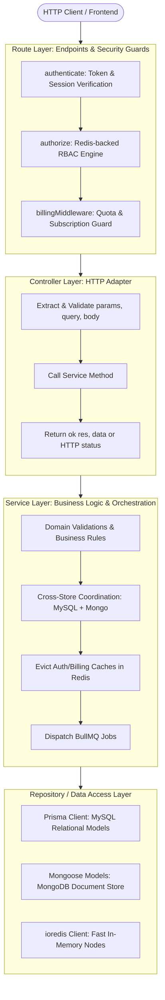

# System Overview Architecture

## 1. Introduction

**EasyStack** is a multi-tenant backend platform for managing application schemas, structured JSON feeds, automated and human-in-the-loop multi-language localizations, and scheduled environment releases. It provides an enterprise-ready headless CMS and localization engine designed for high throughput, strict role-based access control, and seamless deployment across multi-tier environments (e.g., development, staging, production).

---

## 2. Technology Stack

| Layer / Concern | Technology | Purpose | Key References |
|---|---|---|---|
| **Runtime & Language** | Node.js (v20+), TypeScript (v5.9+) | Server runtime & strict type safety | [`package.json`](file:///home/eteknas/Projects/easystack-backend/package.json), [`tsconfig.json`](file:///home/eteknas/Projects/easystack-backend/tsconfig.json) |
| **HTTP Framework** | Express 5.2 | REST API routing and middleware pipeline | [`src/server.ts`](file:///home/eteknas/Projects/easystack-backend/src/server.ts), [`src/routes/`](file:///home/eteknas/Projects/easystack-backend/src/routes) |
| **Relational Data ORM** | Prisma 6.2 (MySQL 8 / MariaDB) | Workspaces, Projects, Users, RBAC, Subscriptions, Storage intents | [`prisma/schema.prisma`](file:///home/eteknas/Projects/easystack-backend/prisma/schema.prisma), [`src/db/prisma.ts`](file:///home/eteknas/Projects/easystack-backend/src/db/prisma.ts) |
| **Document Store** | MongoDB (Mongoose 9.1) | Dynamic JSON Feeds, Blueprints, Content Entries, Comments, Audit Logs | [`src/models/`](file:///home/eteknas/Projects/easystack-backend/src/models), [`src/db/mongo.ts`](file:///home/eteknas/Projects/easystack-backend/src/db/mongo.ts) |
| **In-Memory Cache & Broker** | Redis 7 (ioredis 5.9) | Authorization cache (`authorization:v1:<userId>`), Billing context, Ephemeral OTPs, BullMQ backend | [`src/db/redis.ts`](file:///home/eteknas/Projects/easystack-backend/src/db/redis.ts), [`src/config/redis.ts`](file:///home/eteknas/Projects/easystack-backend/src/config/redis.ts) |
| **Background Processing** | BullMQ 5.67 & Bull-Board 9.4 | Async email dispatch, storage GC, translation workers, cleanup, and scheduled releases | [`src/infrastructure/queue/`](file:///home/eteknas/Projects/easystack-backend/src/infrastructure/queue), [`src/workers/`](file:///home/eteknas/Projects/easystack-backend/src/workers) |
| **Object Storage** | AWS SDK v3 S3 / MinIO | Presigned asset uploads, CDN delivery, intent verification | [`src/services/storage/`](file:///home/eteknas/Projects/easystack-backend/src/services/storage), [`infra/storage/`](file:///home/eteknas/Projects/easystack-backend/infra/storage) |
| **Configuration & Validation** | Zod 4.3 | Validated runtime configuration with coercion | [`src/config/env.ts`](file:///home/eteknas/Projects/easystack-backend/src/config/env.ts), [`src/config/index.ts`](file:///home/eteknas/Projects/easystack-backend/src/config/index.ts) |
| **Logging** | Winston 3.19 (Daily Rotate File) | Structured request, security, and deletion logging | [`src/utils/logger.ts`](file:///home/eteknas/Projects/easystack-backend/src/utils/logger.ts), [`src/middlewares/request-logger.middleware.ts`](file:///home/eteknas/Projects/easystack-backend/src/middlewares/request-logger.middleware.ts) |

---

## 3. Core Architectural Principles & Layer Enforcement

The application enforces a strict **Route -> Controller -> Service -> Repository** pattern. Bypassing layers (e.g., controllers executing database queries or services handling raw HTTP request objects) is strictly prohibited.

### Layer Responsibilities

1. **Route (`src/routes/`)**:
   - Declares HTTP methods and URL paths.
   - Attaches route-level security and tenant-filtering middleware in exact order:
     1. `authenticate`: Verifies JWT access token or session cookie.
     2. `authorize({ scope, permission, scopeId })`: Validates permissions against the pre-compiled Redis authorization node.
     3. `billingMiddleware(workspaceIdFn, { subscription, quotas })`: Verifies tenant subscription health and consumes quota units.
   - Forwards sanitized requests to controller functions.

2. **Controller (`src/routes/*/*.controller.ts`)**:
   - Extracts and sanitizes request parameters, query strings, and payloads.
   - Never contains business logic or direct database queries.
   - Delegates execution to domain services.
   - Formats responses using the standardized `ok(res, data)` helper or passes errors to `next(error)`.

3. **Service (`src/services/`)**:
   - Contains all domain business logic, state machines, and calculations.
   - Coordinates multi-database transactions across MySQL and MongoDB.
   - Enforces business invariants (e.g., JSON structural validation, wildcard matching, quota checks).
   - Manages side effects: enqueuing BullMQ background jobs and evicting Redis caches (`AuthorizationCacheService.evict(userId)`).

4. **Repository (`src/repositories/` and `src/models/`)**:
   - Encapsulates all data access logic for MySQL (via Prisma Client) and MongoDB (via Mongoose).
   - Enforces soft-delete filtering (`removedAt: null`).
   - Isolates complex SQL and NoSQL queries from business logic.

---

## 4. Fundamental Security & Data Invariants

### 1. Soft Deletion Invariant
Entities representing users, workspaces, workspace members, projects, and project members are **never** hard-deleted using raw `DELETE` SQL statements.
- Deletions are performed by setting `removedAt: new Date()`.
- **All retrieval queries must explicitly include `removedAt: null`**.
- Relational joins (such as fetching workspace or project members) must verify that both the membership record and the target user have `removedAt: null`.

### 2. Configuration as Source of Truth
Roles, quota definitions, and permission matrices are defined in code:
- Roles & Permissions: [`src/services/authorization/configs/`](file:///home/eteknas/Projects/easystack-backend/src/services/authorization/configs)
- Quotas: [`src/services/billing/config/quotas.config.ts`](file:///home/eteknas/Projects/easystack-backend/src/services/billing/config/quotas.config.ts)
- System limits and permission grants must **never** be hardcoded into standalone SQL migrations.

### 3. Implicit Inheritance in Multi-Tenancy
- When a user is assigned `WORKSPACE_OWNER` or `WORKSPACE_ADMIN`, the authorization engine automatically synthesizes `PROJECT_OWNER` or `PROJECT_ADMIN` rights for *every* project in that workspace during Redis cache synthesis.
- To prevent hidden-state security anomalies, promoting a user to workspace admin triggers soft deletion of their explicit project-member entries.

### 4. Global Error Handling
- All route controllers are wrapped or routed through async error handling so unhandled promise rejections are piped to [`src/middlewares/error-handler.middleware.ts`](file:///home/eteknas/Projects/easystack-backend/src/middlewares/error-handler.middleware.ts), returning uniform JSON errors without crashing the Node.js process.
