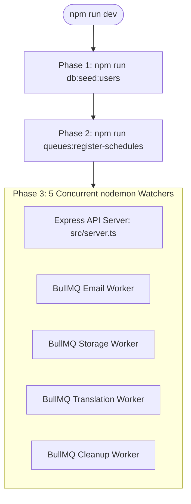

# Daily Development Workflow

## 1. Running the Local Stack

The primary command for day-to-day development is:

```bash
npm run dev
```

### What `npm run dev` Executes Under the Hood
As configured in [`package.json`](file:///home/eteknas/Projects/easystack-backend/package.json), running `npm run dev` executes three phases automatically:



1. **Seed Core Data & Test Users** (`npm run db:seed:users`): Ensures roles, billing quotas, and default users are up-to-date in MySQL.
2. **Register Queue Schedules** (`npm run queues:register-schedules`): Enqueues recurring cron jobs in Redis for storage reconciliation and release checking.
3. **Boot Multi-Process Watchers via `concurrently`**:
   - Express API Server (`src/server.ts`) with nodemon hot reloading.
   - Email Worker watching `src/services/email`.
   - Storage Worker watching `src/services/storage`.
   - Translation Worker watching `src/services/feed`.
   - Cleanup Worker watching `src/services/cleanup`.

---

## 2. Running Individual Worker Groups

When testing specific background jobs without starting the entire stack, run dedicated worker scripts:

```bash
# Run all worker groups in a single worker process
npm run worker:all

# Run individual worker groups
npm run worker:email
npm run worker:storage
npm run worker:translation
npm run worker:cleanup
npm run worker:release
```

---

## 3. Operational Monitoring & Logs

### Visual Queue Dashboard (Bull-Board)
- **URL**: `http://localhost:3000/admin/queues`
- Displays real-time job states for all 6 active queues (`translation`, `email`, `storage`, `cleanup`, `scheduled-release`, `deployment`).
- Allows manual retry, inspection of job payloads, and error trace exploration.

### Application Log Files
Structured Winston logs with daily rotation are persisted in [`storage/logs/`](file:///home/eteknas/Projects/easystack-backend/storage):
- `storage/logs/easystack-*.log`: General application and service logs.
- `storage/logs/requests-*.log`: HTTP request details, status codes, and execution latencies.
- `storage/logs/deletion-*.log`: Soft deletion and external cleanup audit trail.

---

## 4. Production Build & Deployment

To compile and execute the production build:

```bash
# 1. Compile TypeScript to JavaScript in dist/
npm run build

# 2. Deploy database migrations in production
npm run prisma:deploy

# 3. Start production server
npm start
```
