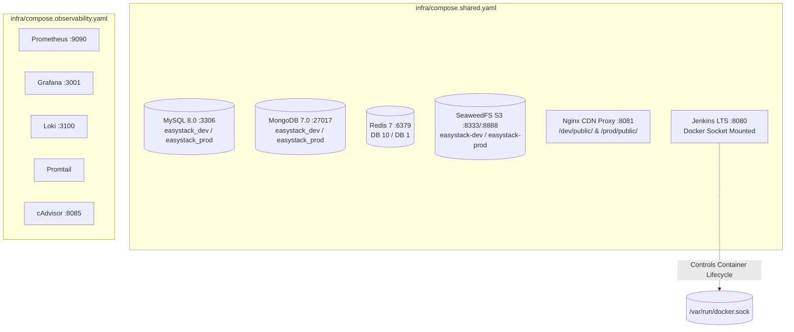

# Shared Infrastructure, Docker Containers & Jenkins CI/CD

This document details the shared common infrastructure setup, Docker containerization, and Jenkins CI/CD controller configuration for EasyStack.

---

## 1. Architecture Overview

EasyStack uses a shared infrastructure model hosting stateful data stores, object storage, and CI/CD tools that serve both **Development** and **Production** environments with strict logical database and bucket separation.



---

## 2. Shared Common Services

### A. MySQL 8.0 (`easystack-mysql`)
* **Image**: `mysql:8.0.36`
* **Port**: `3306:3306`
* **Volumes**: `mysql_data:/var/lib/mysql`
* **Initialization Script**: `infra/init-scripts/01-init-mysql.sh`
  * Reads `$ENVIRONMENTS` (comma-separated, default: `dev,staging,prod`).
  * Dynamically creates `easystack_<env>` and `easystack_<env>_shadow` for each environment.
  * Grants DDL privileges to `easystack_migrate` and runtime DML privileges to `easystack_app`.
* **Health Check**: `mysqladmin ping -h localhost`

### B. MongoDB 7.0 (`easystack-mongodb`)
* **Image**: `mongo:7.0.6`
* **Port**: `27017:27017`
* **Volumes**: `mongo_data:/data/db`
* **Initialization Script**: `infra/init-scripts/02-init-mongo.sh`
  * Reads `$ENVIRONMENTS` and dynamically provisions database roles for `easystack` on `easystack_<env>`.
* **Health Check**: `mongosh --eval "db.adminCommand('ping')"`

### C. Redis 7 (`easystack-redis`)
* **Image**: `redis:7.2.4-alpine`
* **Port**: `6379:6379`
* **Volumes**: `redis_data:/data` (AOF persistence enabled)
* **Logical Separation**: Configured per environment via `REDIS_DB` index (e.g. `10` for Dev, `2` for Staging, `1` for Prod) and key namespace prefixes (`easystack:<env>:*`).
* **Health Check**: `redis-cli ping`

### D. SeaweedFS Distributed Storage & Provisioner (`easystack-seaweedfs` & `easystack-seaweedfs-init`)
* **Image**: `chrislusf/seaweedfs:3.80`
* **Ports**: `8333:8333` (S3 API), `9333:9333` (Master status & Web UI), `8888:8888` (Filer Web UI / API)
* **Volumes**: `seaweed_data:/data`, `./configs/seaweedfs/s3.json:/etc/seaweedfs/s3.json:ro`
* **S3 IAM Configuration**: `infra/configs/seaweedfs/s3.json` configures admin credentials and anonymous read access on `easystack-*` buckets.
* **Provisioner**: Ephemeral Alpine container executes `infra/configs/seaweedfs/seaweedfs-init.sh`:
  * Loops over `$ENVIRONMENTS` and creates `easystack-<env>` directories under `/buckets/` in the SeaweedFS Filer.
  * Creates `/public/` subfolders for immediate public CDN caching.
* **Health Check**: `wget -q -O - http://localhost:8888/`

### E. CDN Caching Proxy (`easystack-cdn`)
* **Image**: `nginx:1.25.4-alpine`
* **Port**: `8081:80`
* **Volumes**: `nginx_cache:/var/cache/nginx`
* **Dynamic Regex Routing**: `infra/configs/cdn/nginx.conf`
  * Matches `/<env>/public/<asset>` via regex capture and dynamically routes to `http://seaweedfs:8333/easystack-<env>/public/<asset>`.
  * Automatically supports **any** new environment without modifying Nginx configuration.
  * Caches responses in the shared `storage_public` cache zone keyed by `"$env$request_uri"`.
  * `/health` health check endpoint.

### F. Jenkins CI/CD Controller (`easystack-jenkins`)
* **Dockerfile**: `infra/docker/jenkins.Dockerfile` based on `jenkins/jenkins:lts-jdk17`
* **Pre-installed Tooling**: Docker CLI, Docker Compose v2 plugin, Git, jq, curl
* **Integration**: Mounts `/var/run/docker.sock` to control host Docker engine for container builds and deployment rolling updates.
* **Ports**: `8080:8080` (Web UI), `50000:50000` (Agent communication)
* **Volumes**: `jenkins_home:/var/jenkins_home`

---

## 3. Observability Services (`infra/compose.observability.yaml`)

* **Prometheus (`:9090`)**: Scrapes Dev and Prod backend APIs, delivery servers, and container metrics with `{env="dev"}` and `{env="prod"}` labels.
* **Grafana (`:3001`)**: Dashboards pre-provisioned with Prometheus and Loki data sources.
* **Loki (`:3100`) & Promtail**: Collects structured logs from containers and files.
* **cAdvisor (`:8085`)**: Container health and resource metrics.

---

## 4. Operational Commands

> [!IMPORTANT]
> Always use `docker compose` (with a space, Docker Compose v2). Do NOT use legacy `docker-compose` (with a hyphen, Python v1) as modern Docker Engine 26+ inspect schemas will cause it to crash with `KeyError: 'ContainerConfig'`.

### Verify Configurations
```bash
./infra/scripts/verify-shared.sh
```

### Start Shared Infrastructure
```bash
cd infra
docker compose -p easystack-shared -f compose.shared.yaml up -d
```

### Start Observability Stack
```bash
cd infra
docker compose -p easystack-observability -f compose.observability.yaml up -d
```

### Provision an Arbitrary New Environment On-Demand
To dynamically provision MySQL, MongoDB, and SeaweedFS storage for any new environment (e.g. `staging`, `qa`, `feature-123`) without restarting running containers:
```bash
./infra/scripts/provision-environment.sh staging
```

### Inspect Container Health
```bash
docker compose -p easystack-shared -f compose.shared.yaml ps
```

---

## 5. Application Stack Deployment (`infra/compose.app.yaml`)

The application compose stack uses `env_file: [ ${ENV_FILE:-./env/.env.dev} ]` to automatically load all configurations from `infra/env/.env.<env>` into all services (`backend-api`, `backend-delivery`, `backend-workers`, and `frontend`). This eliminates manual duplication in `compose.app.yaml` for third-party credentials (such as Google OAuth and Brevo transactional email) and allows driving configuration seamlessly via a single config file or an external Secret Manager (AWS Secrets Manager, HashiCorp Vault, Infisical, Doppler, or Docker Compose Secrets).

### Deploy Development Application Stack
```bash
./infra/scripts/deploy-app.sh dev
```
Or manually:
```bash
cd infra
docker compose -p easystack-dev -f compose.app.yaml --env-file env/.env.dev up -d
```

### Deploy Production Application Stack
```bash
./infra/scripts/deploy-app.sh prod
```
Or manually:
```bash
cd infra
docker compose -p easystack-prod -f compose.app.yaml --env-file env/.env.prod up -d
```

---

## 6. Central Master Commands Reference
For complete copy-pasteable commands, credentials, port allocations, teardown instructions, and architecture references, see [`infra/SETUP_AND_COMMANDS.md`](../../infra/SETUP_AND_COMMANDS.md).

---

## 7. Jenkins CI/CD Pipelines (`infra/ci/`)

EasyStack provides 3 decoupled Declarative Pipelines:

1. **`infra/ci/Jenkinsfile.infra`**: Deploys/updates shared data stores (MySQL, Mongo, Redis, SeaweedFS, CDN, and Observability).
2. **`infra/ci/Jenkinsfile.backend`**: MultiBranch pipeline for Backend Core API, Delivery API, and Workers. Runs tests, builds the backend image, applies Prisma migrations, rolls out containers, and validates health probes with auto-rollback.
3. **`infra/ci/Jenkinsfile.frontend`**: MultiBranch pipeline for Next.js frontend. Runs linting, compiles standalone image, rolls out frontend container, and verifies HTTP 200 responsiveness.

