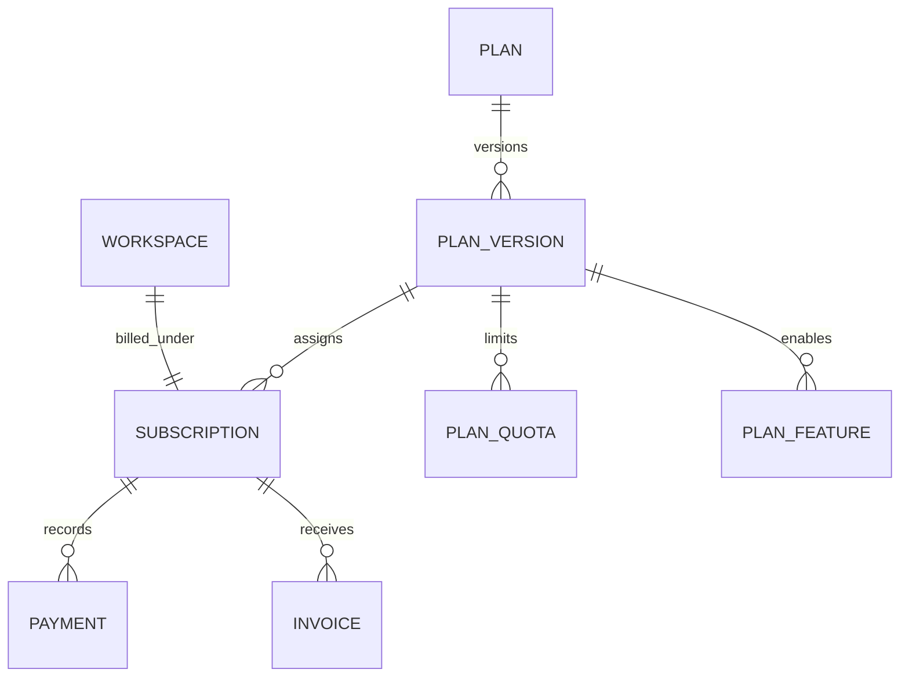

# Billing & Quota Enforcement Module

## 1. Purpose & Responsibilities

The **Billing & Quota Enforcement Module** manages SaaS subscription tiers, plan versions, feature gates, usage metering, and payment gateway synchronizations (Stripe). Subscriptions in EasyStack are tied strictly to **Workspaces** (tenants), not individual users.

### Core Responsibilities
- Maintain plan catalog and immutable plan version histories in MySQL via Prisma (`Plan`, `PlanVersion`).
- Enforce feature flags and quota consumption via the Express `billingMiddleware`.
- Track real-time quota usage across key metrics (`projects`, `members`, `environments`, `storage_mb`, `api_requests`, `ai_tokens`).
- Manage recurring quota resets via scheduled jobs ([`src/services/billing/jobs/quota-reset.job.ts`](file:///home/eteknas/Projects/easystack-backend/src/services/billing/jobs/quota-reset.job.ts)).
- Synchronize customer subscriptions and invoices via payment gateway webhooks (Stripe).
- Cache billing context in Redis (`billing:context:<workspaceId>`) to prevent database overhead on metered API calls.

---

## 2. File Responsibility Map

```text
src/
├── routes/
│   ├── billing/
│   │   ├── billing.routes.ts           # Mounted at /api/billing
│   │   ├── billing.controller.ts      # Workspace plan & subscription endpoints
│   │   └── webhook.route.ts            # Stripe webhook handler: POST /api/billing/webhook/:gateway
│   └── public/billing/
│       ├── billing.routes.ts           # Public route: GET /api/public/billing/plans
│       └── billing.controller.ts      # Public plan catalog listing
│
├── services/billing/
│   ├── index.ts                        # Module entrypoint exporting services and middleware
│   ├── services/
│   │   ├── billing.service.ts          # High-level facade for workspace billing context
│   │   ├── subscription.service.ts     # Workspace plan assignment, trials, cancellations
│   │   ├── quota.service.ts            # Quota allocation, balance check, consumption
│   │   ├── usage.service.ts            # Usage counter increments and ledger tracking
│   │   ├── plan.service.ts             # Plan definitions and version resolution
│   │   ├── feature.service.ts          # Feature flag verification
│   │   └── reset.service.ts            # Quota reset engine for billing cycles
│   ├── middleware/express/
│   │   └── billing.middleware.ts       # billingMiddleware(workspaceIdFn, options) guard
│   ├── config/
│   │   ├── quotas.config.ts            # Quotas dictionary (key, type, resetPolicy, defaultLimit)
│   │   ├── plans.config.ts             # Default plan definitions (Free, Pro, Enterprise)
│   │   └── features.config.ts          # Feature keys
│   ├── cache/
│   │   ├── billing.context.service.ts  # Redis cache for workspace billing state
│   │   └── billing.lock.service.ts     # Distributed locks preventing race conditions in usage
│   ├── payment/
│   │   ├── payment.service.ts          # Checkout sessions, customer portal links
│   │   └── stripe.adapter.ts           # Stripe SDK wrapper & webhook signature validation
│   └── repositories/
│       ├── plan.repository.ts          # Prisma Plan & PlanVersion queries
│       ├── subscription.repository.ts  # Prisma Subscription queries
│       ├── quota.repository.ts         # Prisma PlanQuota queries
│       └── usage.repository.ts         # Usage record persistence
```

---

## 3. Subscription Data Models (Prisma)

Subscriptions are attached to Workspaces via a strict 1-to-1 relation:



- **`Subscription`**: Holds `workspaceId` (unique), `planVersionId`, `status` (`TRIAL`, `ACTIVE`, `PAST_DUE`, `CANCELLED`), `gatewayCustomerId`, and `gatewaySubscriptionId`.
- **`PlanVersion`**: Immutable snapshot of plan pricing, features, and quotas. Existing tenant subscriptions remain pinned to their version even if a plan's prices change.

---

## 4. `billingMiddleware` Enforcement

The `billingMiddleware` ([`src/services/billing/middleware/express/billing.middleware.ts`](file:///home/eteknas/Projects/easystack-backend/src/services/billing/middleware/express/billing.middleware.ts)) gates endpoints based on plan limits.

### Usage in Routes
```typescript
router.post(
  '/',
  authenticate,
  authorize({ scope: 'workspace', permission: PERMISSIONS.PROJECT.CREATE, scopeId: req => req.body.workspaceId }),
  billingMiddleware(
    req => Number(req.body.workspaceId),
    {
      subscription: true, // Requires ACTIVE or TRIAL subscription
      quotas: [
        {
          key: Quotas.PROJECTS.key,
          amount: 1,
          consume: true, // Atomically increments usage if request succeeds
        }
      ]
    }
  ),
  createProject
);
```

### Quota Metrics
- `projects`: Total active projects in workspace.
- `members`: Total team members in workspace.
- `environments`: Total environments configured per project.
- `storage_mb`: Total asset bytes stored in S3.
- `api_requests`: Metered API calls per billing month.
- `ai_tokens`: Consumed LLM tokens for auto-translation.
