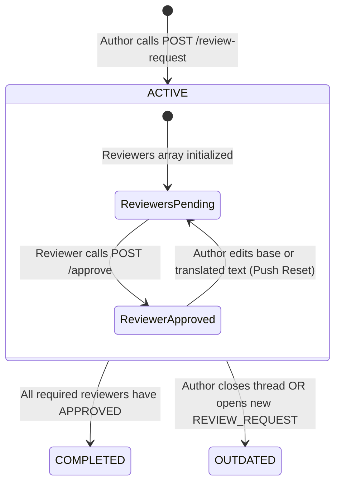

# Collaboration & Review Lifecycle Module

## 1. Purpose & Responsibilities

The **Collaboration & Review Lifecycle Module** embeds GitHub PR-style review threads directly into feed translation workflows. Instead of maintaining disjoint comment and review collections, **everything is modeled as a Comment** (`FeedComment`).

### Core Responsibilities
- Manage single-threaded, PR-style translation review requests (`REVIEW_REQUEST`).
- Track reviewer approval statuses (`PENDING`, `APPROVED`, `REJECTED`).
- Enforce the **Automatic Approval Reset** mechanic: any change to base or translated content resets all approvals back to `PENDING`.
- Automatically inject timeline system messages (e.g., approvals, reviewer additions, text modifications).
- Ensure data privacy by scrubbing content on deleted comments.
- Prevent parallel active reviews by auto-closing previous threads as `OUTDATED`.

---

## 2. File Responsibility Map

```text
src/
├── routes/feeds/
│   └── collaboration.controller.ts     # Comment CRUD, review requests, approvals, reviewer management
│
├── services/
│   └── collaboration.service.ts        # Review state machine, approval resets, system comments
│
└── models/
    └── feed-comment.model.ts           # Mongoose model: FeedComment (single root thread & replies)
```

---

## 3. The Review State Machine & Approval Reset

A feed translation can only have **one active review** at a time:



### The "Push Reset" Mechanic
Just like pushing a new commit to a GitHub pull request invalidates previous approvals, modifying translation content or the base English text triggers an automatic reset:
- Editing localized content resets all `APPROVED` voters back to `PENDING`.
- Editing base content resets all `APPROVED` voters back to `PENDING`.
- **Implementation Detail**: Uses MongoDB's atomic positional operator to bypass Mongoose nested array change-tracking limitations:
  ```typescript
  await FeedComment.updateMany(
    { _id: activeReviewId },
    { $set: { "reviewers.$[].status": "PENDING" } }
  );
  ```

---

## 4. System-Generated Messages

To provide a clean audit history in the chat UI, [`CollaborationService`](file:///home/eteknas/Projects/easystack-backend/src/services/collaboration.service.ts) automatically injects system comments:

| Trigger Event | Injected System Message | Thread Position |
|---|---|---|
| **Request Review** | `<Author> has asked for a review.` | Root Comment |
| **Approve** | `<Reviewer> approved the translation.` | Reply |
| **Add Reviewer** | `<Author> added <New User> as reviewers.` | Reply |
| **Close Review** | `<Author> closed this review request.` | Reply |
| **Author Updates Translation** | `<Author> made changes to the translation. Approvals reset.` | Reply |
| **Author Updates Base Content** | `<Author> made changes to base content. Approvals reset.` | Reply |

### System Comment Technical Invariant
System comments are created with `authorId: -1` and `isSystem: true`. When populated for API responses, the service intercepts `authorId: -1` and returns `author: null`, avoiding failed relational lookups in Prisma while signaling to frontend clients that the message was system-generated.
