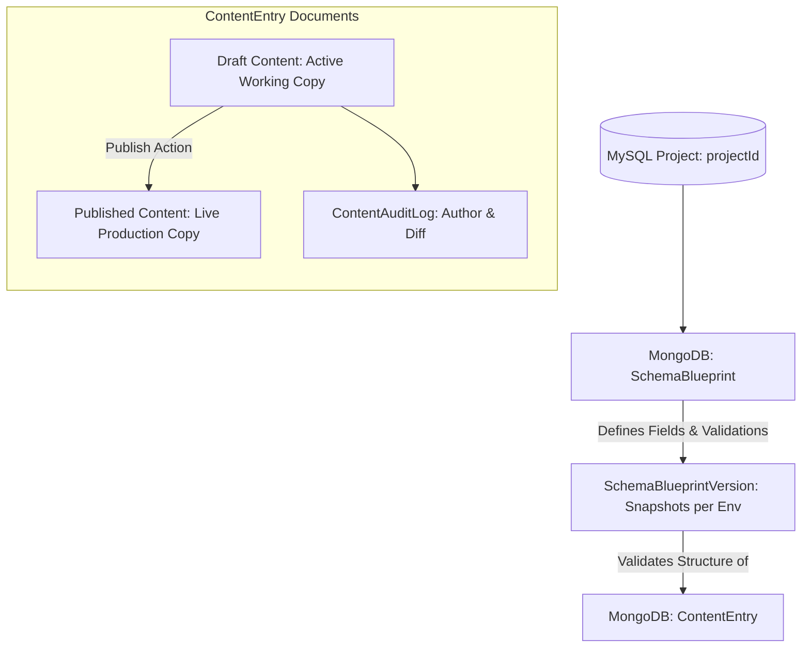

# Content & Schemas Module

## 1. Purpose & Responsibilities

The **Content & Schemas Module** acts as EasyStack's flexible headless CMS engine. It allows developers to define dynamic **Schema Blueprints** (content types with custom fields, types, and validation rules) and allows content authors to create, edit, version, and publish **Content Entries** conforming to those blueprints.

### Core Responsibilities
- Create and manage Schema Blueprints with field definitions and type validation.
- Maintain versioned blueprint snapshots across environments (`SchemaBlueprintVersion`).
- Author, validate, and store Content Entries (`ContentEntry`).
- Support draft versus published states and revision histories.
- Verify slug uniqueness per schema and project.
- Synchronize content across deployment environments (`syncEnvironmentData`).
- Record chronological content change history in `ContentAuditLog`.

---

## 2. File Responsibility Map

```text
src/
├── routes/
│   ├── schemas/
│   │   ├── schema-blueprint.routes.ts      # Mounted at /api/projects/:projectId/schemas
│   │   └── schema-blueprint.controller.ts # Blueprint CRUD, slug check, deploy to environment
│   └── content/
│       ├── content-entry.routes.ts         # Mounted at /api/projects/:projectId/content
│       └── content-entry.controller.ts    # Content CRUD, publish, environment sync, audit
│
├── services/
│   ├── schema-blueprint.service.ts         # Schema creation, field validation, versioning
│   ├── content-entry.service.ts            # Entry drafting, schema conformance, publishing
│   └── content-audit.service.ts            # Content audit trail logger
│
├── repositories/
│   ├── schema-blueprint.repository.ts      # Data access layer for blueprints
│   └── content-entry.repository.ts         # Data access layer for content entries
│
└── models/
    ├── schema-blueprint.model.ts           # Mongoose model: SchemaBlueprint
    ├── schema-blueprint-version.model.ts   # Mongoose model: SchemaBlueprintVersion (snapshot)
    ├── content-entry.model.ts              # Mongoose model: ContentEntry (draft/published data)
    └── content-audit-log.model.ts          # Mongoose model: ContentAuditLog
```

---

## 3. Schemas vs Content Relationship



---

## 4. Key Endpoints & Workflow Capabilities

### Schema Endpoints (`/api/projects/:projectId/schemas`)
- `GET /`: Lists all schema blueprints in the project.
- `GET /check-slug?slug=posts`: Verifies slug availability.
- `POST /`: Creates a new schema blueprint with field definitions.
- `PUT /:schemaId`: Updates a blueprint definition in development. Blueprints in non-development environments cannot be updated directly (`BadRequestError`).
- `POST /:schemaId/deploy`: Deploys the blueprint schema to a designated environment.

### Environment Rank System & Blueprint Read-Only Enforcement
- Projects initialize with 2 default environments ordered by rank: `development` (rank 10, isEditable: true) and `production`/Live (rank 20, isEditable: false).
- Creating additional environments requires plan quota availability (`environments_per_project`).
- Live environment blueprints are strictly read-only snapshots (`SchemaBlueprintVersion`). Users can view blueprints in Live mode, but editing is disabled and schema updates must be deployed through Releases.

### Content Endpoints (`/api/projects/:projectId/content/:schemaSlug`)
- `GET /`: Paginated list of content entries under this schema.
- `GET /check-slug`: Verifies entry slug availability.
- `POST /`: Creates a new content entry draft.
- `PUT /:entryId`: Updates the draft content. When an entry was previously published, saving a draft updates only the working draft copy (`content`) while freezing and preserving the live `publishedContent`. If the entry has localized fields, saving a draft automatically marks target language translation statuses as `outdated` with `outdatedFields`. Saves an audit log entry with action `DRAFT_SAVED`.
- `POST /:entryId/discard-draft`: Discards draft changes and restores content to the live `publishedContent` snapshot. If the schema defines localized fields, marks target language translation statuses as `outdated` with `outdatedFields`. Logs an audit action `DRAFT_DISCARDED`.
- `POST /:entryId/publish`: Promotes the draft content to the published state (`publishedContent = content`). Accepts `{ forcePublish?: boolean }`.
  - Normal Publish (`forcePublish: false`): If the schema contains localized fields, publication is strictly blocked with HTTP 400 until all configured target language translations are completed without outdated fields.
  - Force Publish (`forcePublish: true`): Bypasses unready translation checks, marks all configured target languages in `translationStatuses` as `completed` with `outdatedFields: []` as-is, and proceeds with publication. Logs an audit entry with action `PUBLISHED` and `forcePublished: true` in details.
- `POST /:entryId/translate`: Enqueues automated translation jobs for localized fields. If project target languages were unconfigured, defaults to standard target languages (`['es', 'fr']`) and registers them on the project.
- `POST /sync-environments`: Syncs content data between environments (e.g., development to staging).
- `GET /:entryId/audit-logs`: Retrieves audit logs for the content entry (tracking actions: `CREATED`, `UPDATED`, `DRAFT_SAVED`, `PUBLISHED`, `SCHEDULED`, `AI_TRANSLATED`, `AI_TRANSLATION_TRIGGERED`, `TRANSLATION_OVERRIDDEN`, `SYNCED`, `DRAFT_DISCARDED`, `DELETED`).

---

## 5. Background AI Translation Processing & Publication Guards
- Translation requests are dispatched via BullMQ to the `translation-queue`.
- BullMQ Redis connections require `maxRetriesPerRequest: null` (configured in `src/config/redis.ts`) to allow blocking list operations (`BRPOPLPUSH`/`BLMOVE`) without triggering connection timeout errors.
- Workers asynchronously process pending translations per language and persist completed entries with status tracking (`pending`, `processing`, `completed`, `outdated`, `failed`).
- **Two-Tier Draft Architecture**:
  1. *Local Autosave*: Debounced (1000ms) client-side storage in browser `localStorage`. Zero network calls, preventing multi-user typing conflicts and server spam.
  2. *Cloud Draft Save*: Explicitly saves draft changes to MongoDB with action `DRAFT_SAVED`. Marks localized field translations as `outdated` and prompts the user to queue AI translations.
- **Publication Guard & Translation Lifecycle**:
  - *On Draft Save*: Automatically flags localized translations as `outdated` and prompts to trigger AI translation.
  - *On Discard Draft*: Restores published snapshot, marks translations `outdated`, and prompts to re-generate AI translations.
  - *On Publish*: If translations are ready, publishes directly. If translations are pending or outdated, presents an interactive modal offering to generate AI translations, force publish with translations marked ready as-is, or cancel.


