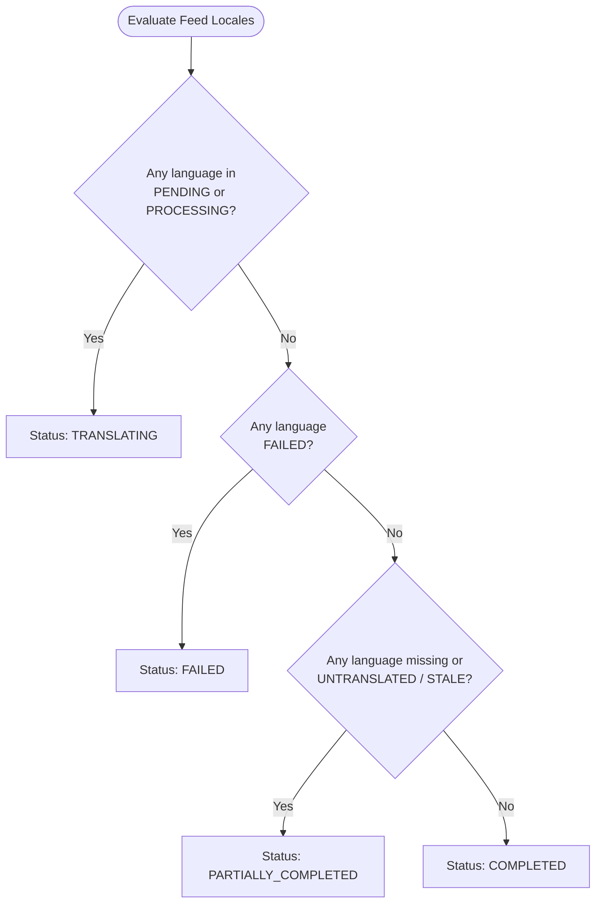

# Feeds & Localization Module

## 1. Purpose & Responsibilities

The **Feeds & Localization Module** is the core engine for authoring structured JSON feeds, validating their structural integrity, managing versioned snapshots per environment, and automating AI-powered multi-language translations with human review workflows.

### Core Responsibilities
- Validate incoming JSON payloads against rigid structural rules and optional schema blueprints.
- Target specific JSON properties for translation using wildcard syntax (`selectedKeys`).
- Maintain versioned feed documents per environment (`FeedVersion`).
- Track translation lifecycles per language locale (`FeedLocalization`).
- Enqueue async translation jobs in BullMQ and execute translation via LLM providers.
- Compute single deterministic aggregate statuses for multi-locale feeds.
- Record comprehensive audit logs for version creation, updates, and translations (`FeedAuditLog`).

---

## 2. File Responsibility Map

```text
src/
├── routes/feeds/
│   ├── feeds.routes.ts                 # Mounted under /api/projects/:projectId/feeds
│   └── feeds.controller.ts             # Feed draft updates, publish, auto-translate triggers
│
├── services/
│   ├── feed.service.ts                 # Core business logic: update draft, compute statuses, publish
│   ├── json-validation.service.ts      # Strict JSON homogeneity, depth, and wildcard validator
│   ├── feed-schema-validation.service.ts # Schema blueprint validation engine
│   ├── llm.service.ts                  # Provider integration for AI translation (e.g., Gemini)
│   └── feed/infrastructure/queue/
│       ├── translation.queue.ts        # BullMQ queue definition: TRANSLATION_QUEUE_NAME
│       ├── translation.producer.ts     # Enqueues translation batch jobs
│       ├── translation.processor.ts    # Worker processor calling LLMService
│       └── createTranslationWorkers.ts # Instantiates translation BullMQ worker pool
│
└── models/
    ├── feed-version.model.ts           # Mongoose model: FeedVersion (baseContent, selectedKeys, schema)
    ├── feed-localization.model.ts      # Mongoose model: FeedLocalization (localizedContent, status)
    └── feed-audit-log.model.ts         # Mongoose model: FeedAuditLog (chronological history)
```

---

## 3. JSON Structural Validation Rules

Before a feed can be saved or localized, [`JsonValidationService`](file:///home/eteknas/Projects/easystack-backend/src/services/json-validation.service.ts) enforces rigid structural requirements:

1. **Object Root**: The root of the JSON payload must be a non-empty JSON Object `{}`.
2. **No Empty Keys**: Keys cannot be empty strings or consist entirely of whitespace.
3. **No Dot Notation in Keys**: Keys cannot contain the `.` character (e.g., `"user.name"` is invalid). This avoids ambiguities with path selection.
4. **Max Depth (10)**: Nesting depth cannot exceed 10 levels.
5. **No 2D Arrays**: Nested arrays (e.g., `[[1, 2], [3, 4]]`) are strictly forbidden.
6. **Strict Array Homogeneity**:
   - Arrays of primitives must be 100% homogenous (all strings, or all numbers).
   - Arrays of objects must contain objects with the **exact same shape** (identical keys).

---

## 4. Wildcard Key Selection (`selectedKeys`)

Users specify which JSON properties to translate using an array of `selectedKeys`. Due to strict array homogeneity, arrays are addressed using the `*` wildcard:

| Path Expression | Match Target |
|---|---|
| `title` | Top-level string field `title` |
| `settings.description` | Nested field `description` within object `settings` |
| `tags.*` | Every primitive string item inside the `tags` array |
| `products.*.name` | The `name` property of every object inside the `products` array |

---

## 5. Translation Lifecycle & Aggregated Status

### Per-Language Lifecycle (`FeedLocalization.status`)
1. **`UNTRANSLATED`**: Language exists in project settings, but no translation has been queued.
2. **`PENDING`**: Translation job is queued in BullMQ Redis queue.
3. **`PROCESSING`**: Worker has picked up the job and is calling the LLM provider.
4. **`COMPLETED`**: Translated JSON returned successfully and persisted to MongoDB.
5. **`FAILED`**: Translation failed permanently or exhausted retries.
6. **`STALE`**: Base English text was updated while a previous translation existed; indicates re-translation or review is required.

### Aggregated Feed Status Priority
Because a feed translates into multiple languages simultaneously, [`FeedService`](file:///home/eteknas/Projects/easystack-backend/src/services/feed.service.ts) evaluates an overall aggregate status in this exact priority:


