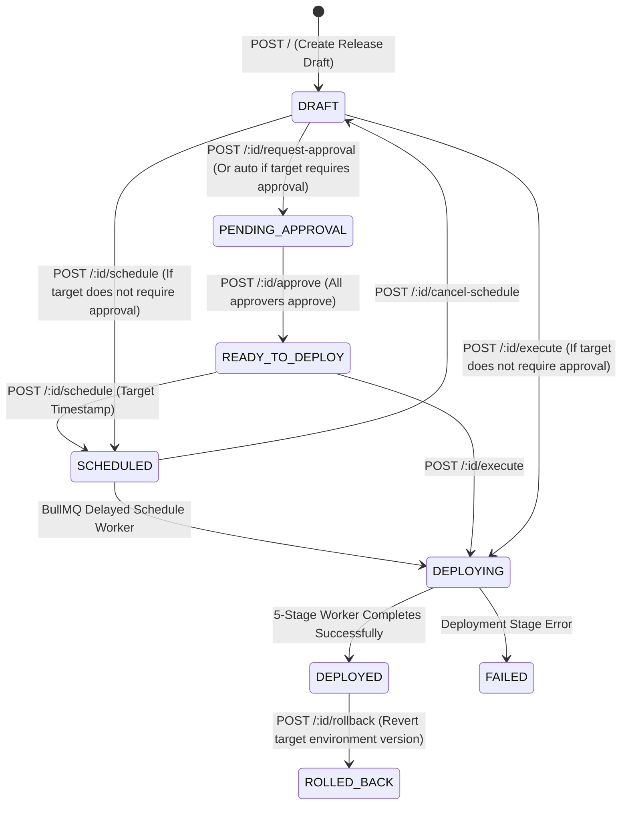

# Releases & Deployment Module

## 1. Purpose & Responsibilities

The **Releases & Deployment Module** provides release engineering, environment staging, and deployment orchestration for EasyStack.

### Promotion Order & Environment Architecture
- **Rank-Based Progression**: Environment promotion paths are strictly determined by the numerical `rank` assigned to each environment (`orderBy: { rank: 'asc' }`). If a project has environments with ranks 10, 20, 30, 40, and 50, promotions strictly proceed: `10 -> 20 -> 30 -> 40 -> 50`.
- **Decoupled Environment Names**: Environment names are fully customizable and never hardcoded in the deployment engine.
- **Default Hierarchy**: By default, new projects are initialized with 2 standard environments: `development` (rank 10, editable) and `production` (rank 20, read-only live serving).
- **Custom Environment Provisions & Quotas**:
  - Backend provision: `createEnvironment` in `ProjectService` enforces workspace subscription quotas via `BillingService.getLimit(workspaceId, 'environments_per_project')`.
  - Quotas: Free plan supports 2 environments default; Pro plan supports up to 5 environments with custom ranks; Enterprise plan supports custom unlimited environments.
  - Future UI: The backend provisions are documented and ready for user-facing custom environment creation screens in upcoming releases.

### Core Responsibilities
- Compute semantic environment diffs between source and target environments for Schema Blueprints based on rank hierarchy.
- Suggest SemVer version increments based on field additions, modifications, or breaking removals.
- Manage release approvals and governance before deployment.
- Atomically deploy releases through a 5-stage pipeline, updating `SchemaBlueprint.environments`, `SchemaBlueprint.deployedAt`, `SchemaBlueprint.environmentVersions`, and snapshotting `SchemaBlueprintVersion`.
- Support instant deployment from the Schema Blueprint editor when no approvers are configured.
- Support scheduled releases executed via BullMQ background queues.
- Support instant rollbacks to previous release snapshots if regressions occur.

---

## 2. File Responsibility Map

```text
src/
├── routes/releases/
│   ├── release.routes.ts               # Mounted at /api/projects/:projectId/releases
│   └── release.controller.ts          # Endpoints: diff, suggest-version, approve, execute, schedule
│
├── services/
│   ├── release.service.ts              # Core release engine: diff computation, execution, multi-stage pipeline, rollback
│   ├── schema-blueprint.service.ts     # Schema blueprints: deployBlueprint integration with release pipeline
│   └── releases/infrastructure/queue/
│       ├── release.queue.ts            # BullMQ release queue definition
│       ├── scheduled-release.queue.ts  # SCHEDULED_RELEASE_QUEUE_NAME & DEPLOYMENT_QUEUE_NAME
│       └── release.worker.ts           # BullMQ worker: processes scheduled releases & async 5-stage deployments
```

---

## 3. The Release State Machine & Lifecycle



---

## 4. Key Endpoints & Execution Details

### 1. Environment Diff & SemVer Suggestion
- `GET /diff?sourceEnvironmentId=1&targetEnvironmentId=2`: Inspects differences between source and target environments for all Schema Blueprints. Returns added, modified, and removed fields.
- `GET /suggest-version`: Analyzes whether changes include field removals/breaking changes (bump MAJOR), field additions (bump MINOR), or patches.

### 2. Creation & Governance
- `POST /`: Creates release record with metadata (`isBlueprintRelease: true`, `blueprintIds`, `blueprintNames`, `blueprints`, `semanticVersion`).
- `POST /:releaseId/request-approval`: Requests approvals from designated project members.
- `POST /:releaseId/approve`: Approves a release. When all assigned approvers approve, status transitions to `READY_TO_DEPLOY`.

### 3. Execution & Deployment Pipeline
- `POST /:releaseId/execute`: Sets status to `DEPLOYING` and enqueues a job into BullMQ `deployment-queue`.
- The multi-stage worker executes 5 discrete stages:
  1. **Pre-flight Schema & Integrity Check**: Validates JSON schema definitions and blueprint references.
  2. **Target Environment State Snapshot & Rollback Point Creation**: Captures preceding versions in target environment.
  3. **Atomic State Pointer Synchronization**: Updates `SchemaBlueprint.environments`, `deployedAt`, `environmentVersions`, and upserts `SchemaBlueprintVersion`.
  4. **Release Artifact Locking & Development Version Branching**: Locks the release version snapshot.
  5. **Cache Invalidation & Traffic Activation**: Activates release and sets status to `DEPLOYED`.
- `POST /:releaseId/schedule`: Submits job to `scheduled-releases-queue` with a future execution timestamp.
- `POST /:releaseId/rollback`: Reverts target environment's version pointers to the preceding release snapshot.
