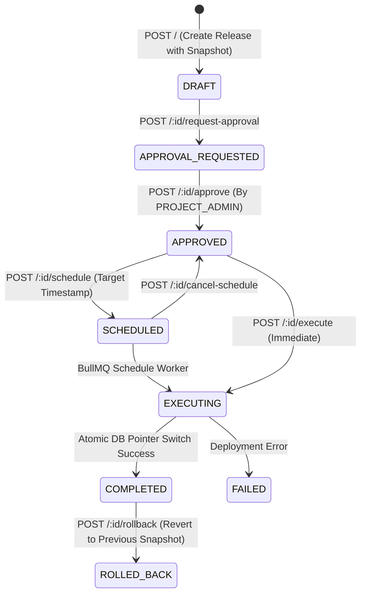

# Releases & Deployment Module

## 1. Purpose & Responsibilities

The **Releases & Deployment Module** provides release engineering, environment staging, and deployment orchestration for EasyStack. Because content can only be edited in editable environments (`development`), all promotions to read-only environments (`staging`, `production`) must pass through the Release pipeline.

### Core Responsibilities
- Compute semantic environment diffs between source and target environments.
- Suggest SemVer version increments based on content versus structural changes.
- Manage release approvals and governance before deployment.
- Atomically deploy releases by updating `EnvironmentState.activeVersionId` in MySQL.
- Support scheduled releases executed via BullMQ background queues.
- Support instant rollbacks to previous release snapshots if regressions occur.

---

## 2. File Responsibility Map

```text
src/
├── routes/releases/
│   ├── release.routes.ts               # Mounted at /api/projects/:projectId/releases
│   └── release.controller.ts          # Endpoints: diff, suggest-version, approve, execute, schedule
│
├── services/
│   ├── release.service.ts              # Core release engine: diff computation, execution, rollback
│   └── releases/infrastructure/queue/
│       ├── release.queue.ts            # BullMQ release queue definition
│       ├── scheduled-release.queue.ts  # SCHEDULED_RELEASE_QUEUE_NAME & DEPLOYMENT_QUEUE_NAME
│       └── release.worker.ts           # startReleaseWorker: processes scheduled & async deployments
```

---

## 3. The Release State Machine & Lifecycle



---

## 4. Key Endpoints & Execution Details

### 1. Environment Diff & SemVer Suggestion
- `GET /diff?sourceEnvId=1&targetEnvId=2`: Inspects differences between source and target feed snapshots. Returns added, modified, and deleted keys.
- `GET /suggest-version`: Analyzes whether changes are breaking (structure changed -> bump MINOR/MAJOR) or content-only (bump PATCH).

### 2. Creation & Governance
- `POST /`: Creates release record with frozen snapshots of all included feeds and schemas.
- `POST /:releaseId/request-approval`: Notifies project administrators that release is ready for review.
- `POST /:releaseId/approve`: Requires `PERMISSIONS.RELEASE.APPROVE`.

### 3. Execution & Deployment
- `POST /:releaseId/execute`: Executes the deployment. In an atomic transaction, updates `EnvironmentState.activeVersionId` for each feed in the target environment to point to the release's version snapshots.
- `POST /:releaseId/schedule`: Submits job to `releaseQueue` with a future execution timestamp.
- `POST /:releaseId/rollback`: Instantly reverts target environment's `activeVersionId` pointers to the preceding release snapshot.
