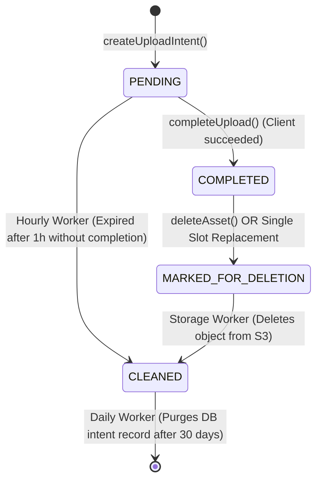

# Object Storage Module

## 1. Purpose & Responsibilities

The **Object Storage Module** provides a secure, intent-based file upload and media resolution service. Files are uploaded **directly from the client browser to object storage** (AWS S3 or MinIO) using presigned POST policies, ensuring the API server never buffers binary file payloads in memory.

### Core Responsibilities
- Validate file constraints (allowed MIME types, maximum size, aspect ratios) before issuing upload permissions.
- Issue short-lived, presigned S3 POST policies constrained by exact key, bucket, and size limits.
- Verify uploaded file integrity upon upload completion via S3 `HEAD Object` checks.
- Map binary assets to domain entities using structured **Targets** and **Slots**.
- Enforce slot cardinality: `SINGLE` (safely replacing and deleting old objects) versus `MULTIPLE`.
- Resolve asset URLs: Public assets via high-speed CDN, Private assets via short-lived signed URLs.
- Reconcile orphaned uploads and garbage-collect uncompleted files via BullMQ background workers.

---

## 2. File Responsibility Map

```text
src/
├── routes/storage/
│   ├── storage.routes.ts               # Mounted at /api/storage
│   ├── storage.controller.ts          # Upload intent creation, completion, presigning
│   └── storage-demo.controller.ts     # User-isolated demo endpoints for testing uploads
│
├── services/storage/
│   ├── index.ts                        # Module export facade & public types
│   ├── storage.instance.ts             # Instantiated singleton of StorageService
│   ├── public/
│   │   ├── StorageService.ts           # Public interface definition
│   │   └── storage.contracts.ts        # Public types (CreateUploadIntentInput, UploadIntentResult, etc.)
│   ├── application/
│   │   ├── DefaultStorageService.ts    # Core application service implementing StorageService operations
│   │   ├── StoragePolicyResolver.ts    # Resolves upload policies by file class
│   │   └── StorageReconciliationService.ts # Reconciles expired intents and orphaned assets
│   ├── domain/
│   │   ├── ObjectKeyBuilder.ts         # Generates deterministic S3 keys from target and slot
│   │   ├── StorageError.ts             # Domain storage errors
│   │   └── storage.records.ts          # Storage upload intent and asset record types
│   ├── ports/
│   │   ├── ObjectStorageProvider.ts    # Port for S3/MinIO operations
│   │   ├── StoragePersistence.ts       # Port for relational persistence (Prisma)
│   │   └── StorageCleanupScheduler.ts  # Port for background scheduling (BullMQ)
│   └── infrastructure/
│       ├── createStorageModule.ts      # Composition factory wiring ports and adapters
│       ├── prisma/
│       │   └── PrismaStoragePersistence.ts # Implements StoragePersistence via Prisma
│       ├── s3/
│       │   └── S3ObjectStorageProvider.ts  # Implements ObjectStorageProvider via AWS SDK v3
│       └── queue/
│           ├── storage.jobs.ts             # BullMQ job descriptors: reconcile, retention
│           ├── storage.producer.ts         # Schedulers: hourly reconciliation, daily retention
│           ├── storage.processor.ts        # Worker processor deleting orphaned S3 objects
│           ├── createStorageWorkers.ts     # BullMQ worker pool factory
│           └── BullMqStorageCleanupScheduler.ts # Implements StorageCleanupScheduler via BullMQ
```

---

## 3. The Target & Slot Model

Files belong to domain resources using a structured hierarchical target:

```typescript
const target = {
  nodes: [
    { collection: 'workspaces', id: '12' },
    { collection: 'projects', id: '45' }
  ],
  slot: 'cover_image' // logical slot identifier
};
```

### Cardinality & Replacement
- **`SINGLE` Slot**: Only one asset can occupy the slot (e.g., workspace logo or user avatar). When a new upload completes, the previous asset is marked removed and its S3 object is scheduled for deletion.
- **`MULTIPLE` Slot**: Multiple assets coexist under the slot (e.g., project gallery attachments).

---

## 4. Visibility & URL Resolution

- **`PUBLIC` Visibility**: Assets are publicly readable. Resolved URLs point directly to the configured CDN edge:
  `${STORAGE_CDN_BASE_URL}/${s3Key}`
- **`PRIVATE` Visibility**: Assets require authentication. Resolved URLs are signed S3 GET URLs that expire after 300 seconds (`STORAGE_PRIVATE_URL_EXPIRY_SECONDS`).

---

## 5. Background Cleanup & Lifecycle

Uploaded files transition through a controlled state machine:


