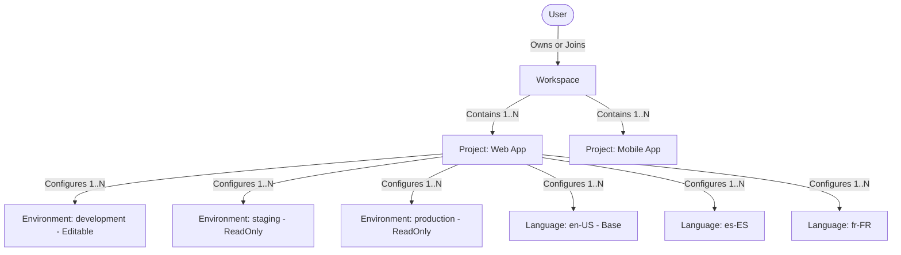

# Multi-Tenancy Module: Workspaces, Projects & Invitations

## 1. Purpose & Responsibilities

The **Multi-Tenancy Module** manages organizational scoping and resource containment in EasyStack. It provides hierarchical tenancy where users organize work into **Workspaces**, and Workspaces partition their assets and schemas into **Projects**. It also manages deployment **Environments**, target **Project Languages**, and the secure **Invitation System**.

### Core Responsibilities
- Workspace lifecycle: creation, branding, metadata update, and soft deletion.
- Project lifecycle: creation with unique subdomains, environment seeding, and member assignments.
- Environment management: configuration of multi-tier deployment targets (`development`, `staging`, `production`) with mutability controls (`isEditable: boolean`).
- Target languages: configuration of supported language locales per project.
- Invitations: secure, privacy-preserving invitations by exact email match, supporting simultaneous workspace and project-level role assignment.

---

## 2. File Responsibility Map

```text
src/
├── routes/
│   ├── workspace/
│   │   ├── workspace.routes.ts         # Routes: /api/workspace
│   │   ├── workspace.controller.ts    # Workspace CRUD, member lists, billing summary
│   │   └── workspace-invite.controller.ts # Workspace member invitations & role management
│   ├── projects/
│   │   ├── projects.routes.ts          # Routes: /api/projects
│   │   ├── projects.controller.ts     # Project CRUD, members, environments, languages
│   │   └── projects.public.controller.ts # Public subdomain check & supported languages
│   └── public/invitations/
│       ├── invitations.routes.ts       # Public route: GET /api/public/invitations/:token
│       └── invitations.controller.ts  # Token inspection for invite landing page
│
├── services/
│   ├── workspace/
│   │   ├── workspace.service.ts        # Workspace business logic, member profile fetch
│   │   └── workspace-invite.service.ts # Invitation token creation, email dispatch, acceptance
│   ├── project.service.ts              # Project creation, subdomain validation, environment init
│   └── user/
│       └── user-invite.service.ts      # User-side invite inbox and acceptance handlers
│
└── repositories/
    ├── workspace.repository.ts         # Prisma Workspace queries with removedAt: null
    ├── project.repository.ts           # Prisma Project queries with removedAt: null
    └── workspace-invitation.repository.ts # Prisma WorkspaceInvitation queries & token updates
```

---

## 3. Core Entities & Tenancy Hierarchy



### 1. Workspaces
- Root tenant container. All billing subscriptions (`Subscription`) are attached to the `Workspace`.
- Members hold a `WorkspaceRole` (`WORKSPACE_OWNER`, `WORKSPACE_ADMIN`, `WORKSPACE_MEMBER`, `WORKSPACE_VIEWER`, `WORKSPACE_GUEST`).

### 2. Projects
- Isolated operational containers belonging to a single workspace.
- Requires a globally unique `subdomain` (checked via `GET /api/projects/subdomain-available/:subdomain`).
- On creation, [`ProjectService.createProject()`](file:///home/eteknas/Projects/easystack-backend/src/services/project.service.ts) automatically seeds:
  1. Default environments: `development` (`isEditable: true`), `staging` (`isEditable: false`), and `production` (`isEditable: false`).
  2. Base language: defaults to `en-US` in `ProjectLanguage`.
  3. Creator assignment: creator becomes `PROJECT_OWNER`.

### 3. Environments & Mutability Control
- Environments define where feed drafts are edited and published.
- **Rule**: Content and feeds can **only be directly edited in editable environments** (`isEditable: true`, normally `development`).
- Non-editable environments (`staging`, `production`) can only receive content via the **Releases** deployment workflow.

---

## 4. The Privacy-Preserving Invitation System

To prevent user enumeration and protect email privacy, EasyStack enforces strict invitation rules:

1. **Exact-Match Search**: Member searches require exact email matching rather than prefix/wildcard search for non-members.
2. **Dual-Role Assignment**: An invitation can grant a workspace role (e.g., `WORKSPACE_MEMBER` or `WORKSPACE_GUEST`) and simultaneously assign specific project roles across multiple projects.
3. **Acceptance Flow**:
   - Invitation sends an email with a secure token.
   - Public endpoint `GET /api/public/invitations/:token` returns invite metadata (workspace name, inviter name, roles) without requiring authentication.
   - User signs in or registers, then calls `POST /api/user/invites/accept-by-token` to complete membership and trigger Redis auth cache eviction.
