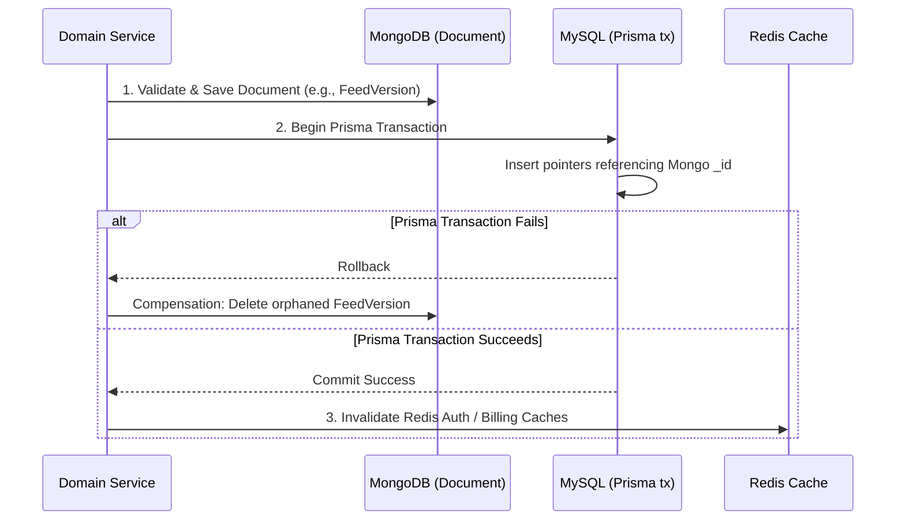

# Database Transactions & Consistency Reference

## 1. Overview & ACID Boundaries

EasyStack uses **Prisma Interactive Transactions** to ensure multi-step database writes succeed or fail atomically. Because the platform uses both MySQL (Prisma) and MongoDB (Mongoose), transactional coordination must account for both relational ACID boundaries and cross-store data consistency.

---

## 2. Interactive Transactions with Prisma

Interactive transactions allow sequential execution of dependent database operations inside an atomic transaction block:

```typescript
import { prisma } from '../db';

export async function createProjectWithDefaults(
  workspaceId: number,
  userId: number,
  name: string,
  subdomain: string
) {
  return await prisma.$transaction(async (tx) => {
    // 1. Create Project
    const project = await tx.project.create({
      data: {
        workspaceId,
        name,
        subdomain,
        resourceId: `proj_${Date.now()}`
      }
    });

    // 2. Seed Default Environments
    await tx.environment.createMany({
      data: [
        { projectId: project.id, name: 'development', isEditable: true },
        { projectId: project.id, name: 'staging', isEditable: false },
        { projectId: project.id, name: 'production', isEditable: false }
      ]
    });

    // 3. Assign Creator as PROJECT_OWNER
    const ownerRole = await tx.role.findUniqueOrThrow({ where: { key: 'PROJECT_OWNER' } });
    await tx.projectMember.create({
      data: {
        projectId: project.id,
        userId,
        roleId: ownerRole.id
      }
    });

    // 4. Seed Default Base Language
    await tx.projectLanguage.create({
      data: {
        projectId: project.id,
        code: 'en-US',
        name: 'English (US)',
        isBase: true
      }
    });

    return project;
  }, {
    timeout: 10000 // 10s max duration to prevent deadlocks
  });
}
```

---

## 3. When to Use Transactions

Use an interactive transaction whenever:
1. **Multi-Table Dependent Inserts**: A parent entity requires dependent rows (e.g., Workspace + WorkspaceMember + Subscription).
2. **State Pointer Switches**: Swapping active environment versions in Releases (`EnvironmentState.activeVersionId`).
3. **Role Promotions with Cleanup**: Promoting a member to Workspace Admin while soft-deleting legacy project-member records.
4. **Quota Usage Increments**: Applying metered usage changes alongside business operations.

---

## 4. Cross-Store Coordination (MySQL + MongoDB)

Distributed Two-Phase Commit (2PC) is not supported across separate MySQL and MongoDB clusters. When an operation touches both relational metadata and document content:

### Golden Rule: In-Memory / Document First, Relational Commit Last


### Invariants:
1. **Never perform external HTTP requests or email sends inside a Prisma transaction block**. External network calls introduce unpredictable latencies that hold database locks open.
2. **Never evict Redis caches inside the transaction block**. Evict Redis keys only **after** the transaction successfully commits. If the transaction rolls back, an eviction inside the block would invalidate cache prematurely.
