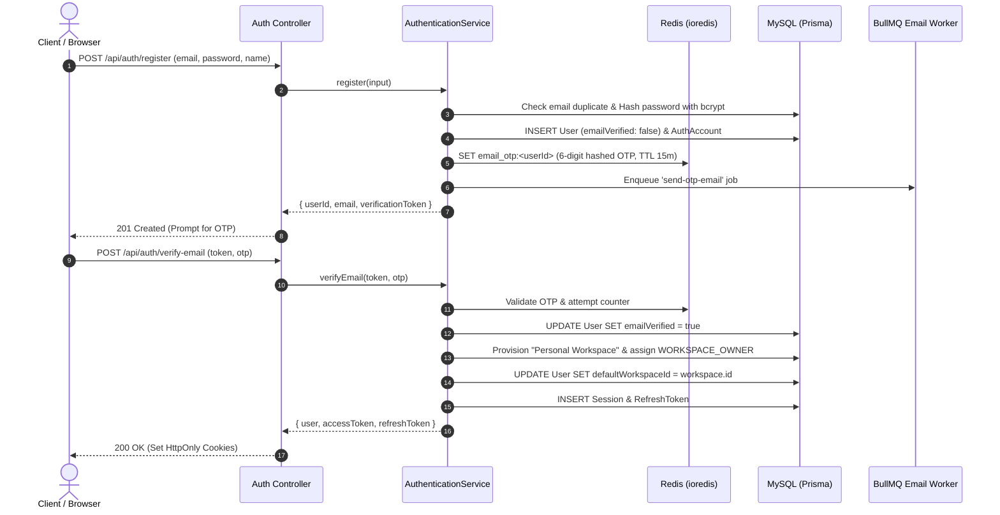

# Authentication & Onboarding Workflow

## 1. Overview & Triggers

This workflow traces the end-to-end user lifecycle from account registration through email verification, personal default workspace provisioning, login session issuance, and token refresh rotation.

### Triggers
- **New User Registration**: `POST /api/auth/register`
- **Email Verification**: `POST /api/auth/verify-email`
- **Password Login**: `POST /api/auth/login`
- **Google OAuth Login**: `POST /api/auth/providers/google`
- **Session Refresh**: `POST /api/auth/refresh`

---

## 2. Sequence Diagram

---

## 3. Step-by-Step Execution Trace

### Phase 1: Registration
1. **Entry**: Client calls `POST /api/auth/register`. Request passes through `authRateLimiter`.
2. **Input Validation**: [`AuthenticationValidationService`](file:///home/eteknas/Projects/easystack-backend/src/services/authentication/services/authentication-validation.service.ts) verifies email syntax and password strength.
3. **Account Creation**: [`AuthenticationRepository`](file:///home/eteknas/Projects/easystack-backend/src/services/authentication/repositories/authentication.repository.ts) checks for existing users. It writes a `User` record with `emailVerified: false` and hashes the password with `bcrypt` (12 rounds) into `AuthAccount`.
4. **OTP Dispatch**: Generates a cryptographically secure 6-digit integer. Stores hash in Redis key `email_otp:<userId>` with a 15-minute TTL. Dispatches `send-otp-email` to BullMQ.

### Phase 2: Email Verification & Default Workspace Provisioning
1. **Entry**: Client calls `POST /api/auth/verify-email` with OTP and verification token.
2. **Verification**: Compares hashed OTP against Redis. Deletes key on match.
3. **Database Update**: Sets `User.emailVerified = true`.
4. **Provisioning Transaction**: [`AccountProvisioningService`](file:///home/eteknas/Projects/easystack-backend/src/services/authentication/services/account-provisioning.service.ts) executes an interactive transaction:
   - Creates a new `Workspace` titled `"<User Name>'s Workspace"`.
   - Creates `WorkspaceMember` assigning role `WORKSPACE_OWNER`.
   - Links user: `UPDATE User SET defaultWorkspaceId = workspace.id`.
5. **Token Generation**: Signs short-lived JWT (15 minutes). Creates a persistent `Session` in MySQL with a high-entropy refresh token hash (7 days). Sets `accessToken` and `refreshToken` in `HttpOnly`, `SameSite: Lax` cookies.

### Phase 3: Token Refresh Rotation
1. **Trigger**: When the 15-minute access token expires, client calls `POST /api/auth/refresh`.
2. **Validation**: Reads refresh token from cookie, verifies signature and validates active status in `Session` table.
3. **Rotation Invariant**: To prevent replay attacks, the old refresh token is immediately revoked, a new refresh token is issued and stored, and a fresh access token is returned.
