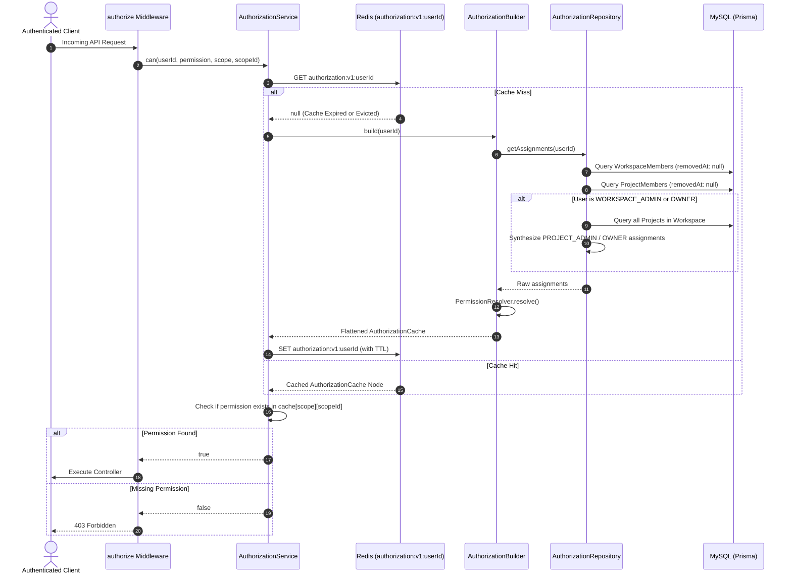

# Authorization Cache Lifecycle Workflow

## 1. Overview & Triggers

This workflow traces the complete lifecycle of a user's authorization state: from request-time cache evaluation and on-demand cache synthesis to explicit invalidation upon role modifications.

### Triggers
- **Request Authorization**: Evaluated on every API endpoint guarded by `authorize({ scope, permission, scopeId })`
- **Role Assignment / Mutation**: `PATCH /api/workspace/:id/members/:userId` or `PATCH /api/projects/:id/members/:userId`
- **Member Removal**: `DELETE /api/workspace/:id/members/:userId` or `DELETE /api/projects/:id/members/:userId`
- **Invitation Acceptance**: `POST /api/user/invites/accept-by-token`

---

## 2. Sequence Diagram



---

## 3. Step-by-Step Execution Trace

### Phase 1: Request Interception & Evaluation
1. **Context Extraction**: The `authorize` middleware extracts the authenticated `userId` from `req.user.id` (set by preceding `authenticate` middleware) and resolves the `scopeId` string (e.g., `req.params.projectId`).
2. **Cache Check**: [`AuthorizationService`](file:///home/eteknas/Projects/easystack-backend/src/services/authorization/services/authorization.service.ts) queries Redis key `authorization:v1:<userId>`.

### Phase 2: On-Demand Cache Building (Cache Miss)
If the cache is absent or expired:
1. **Assignment Collation**: [`AuthorizationRepository`](file:///home/eteknas/Projects/easystack-backend/src/services/authorization/repositories/authorization.repository.ts) queries all active `WorkspaceMember` records for the user.
2. **Implicit Project Synthesis**:
   - If the user holds `WORKSPACE_OWNER` or `WORKSPACE_ADMIN`, the repository queries all projects belonging to the workspace (`prisma.project.findMany({ where: { workspaceId, removedAt: null } })`).
   - It fetches the permission array for `PROJECT_OWNER` or `PROJECT_ADMIN` and synthesizes an assignment node for each project.
   - For regular members, it queries explicit `ProjectMember` records.
3. **Resolution & Merging**: [`PermissionResolver`](file:///home/eteknas/Projects/easystack-backend/src/services/authorization/services/resolve-permissions.ts) collapses role permissions into deduplicated arrays.
4. **Redis Cache Write**: The compiled `AuthorizationCache` object is written to Redis key `authorization:v1:<userId>`.

### Phase 3: Immediate Invalidation on Mutation
When a user's permissions change (e.g., promoted to admin, removed from project, or accepted an invite):
1. The mutating service updates the database record.
2. The service immediately calls:
   ```typescript
   await AuthorizationCacheService.evict(targetUserId);
   ```
3. Redis issues `DEL authorization:v1:<targetUserId>`.
4. The user's subsequent API request automatically triggers a fresh cache build with updated permissions, eliminating stale permission windows.
