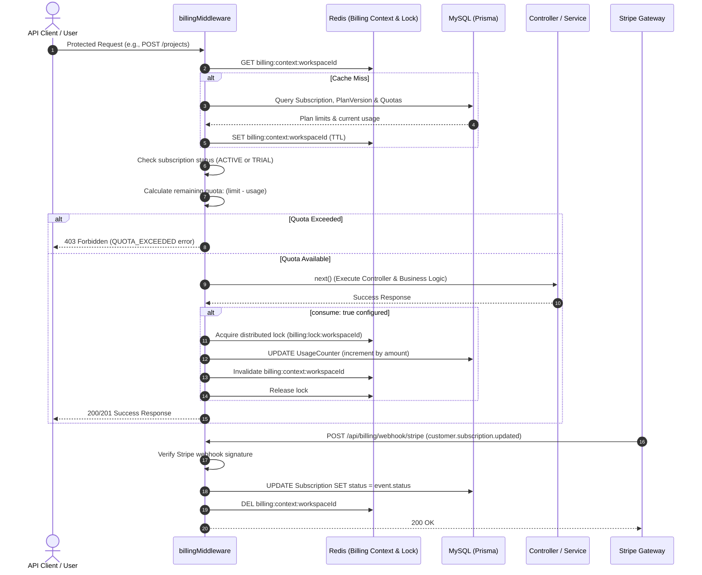

# Billing & Quota Enforcement Workflow

## 1. Overview & Triggers

This workflow traces how EasyStack gates metered API operations through the `billingMiddleware`, evaluates subscription health, meters usage counters with distributed Redis locks, and processes payment gateway webhooks from Stripe.

### Triggers
- **Metered API Request**: Incoming HTTP call on a route protected by `billingMiddleware`
- **Quota Balance Query**: `GET /api/billing/workspaces/:workspaceId/my-plan`
- **Payment Gateway Webhook**: `POST /api/billing/webhook/:gateway` (e.g., Stripe)
- **Recurring Reset Job**: Cron execution of `quota-reset.job.ts`

---

## 2. Sequence Diagram

---

## 3. Step-by-Step Execution Trace

### Phase 1: Request Interception & Quota Evaluation
1. **Target Identification**: [`billingMiddleware`](file:///home/eteknas/Projects/easystack-backend/src/services/billing/middleware/express/billing.middleware.ts) evaluates the `workspaceIdFn` argument (e.g., `req => req.body.workspaceId`) to determine the target tenant workspace.
2. **Context Resolution**: Checks Redis key `billing:context:<workspaceId>`. If absent, [`BillingContextService`](file:///home/eteknas/Projects/easystack-backend/src/services/billing/cache/billing.context.service.ts) queries Prisma for the active `Subscription`, its pinned `PlanVersion`, and all configured `PlanQuota` records, caching the resolved context in Redis.
3. **Status Check**: If `options.subscription: true`, the middleware verifies that `status === 'ACTIVE'` or `status === 'TRIAL'`. Subscriptions in `PAST_DUE` or `CANCELLED` status immediately halt execution with `403 Forbidden`.
4. **Quota Availability Check**:
   - For each quota listed in options (e.g., `{ key: 'projects', amount: 1 }`), it calculates:
     `available = (planLimit + customOverride) - currentUsage`
   - If `available < amount`, request is rejected with `403 Forbidden` (`errorCode: 'QUOTA_EXCEEDED'`) containing detailed quota metadata.

### Phase 2: Consumption & Lock Protection
1. **Post-Execution Consumption**: If `consume: true` is configured, consumption occurs only after the controller logic successfully completes.
2. **Distributed Lock**: [`BillingLockService`](file:///home/eteknas/Projects/easystack-backend/src/services/billing/cache/billing.lock.service.ts) acquires a Redis mutex lock (`billing:lock:<workspaceId>`) to prevent race conditions during concurrent requests.
3. **Usage Increment & Eviction**:
   - Increments the persistent usage ledger in MySQL.
   - Deletes `billing:context:<workspaceId>` from Redis to ensure the next request observes updated usage tallies.
   - Releases the lock.

### Phase 3: Stripe Webhook Synchronization
1. **Signature Verification**: [`webhook.route.ts`](file:///home/eteknas/Projects/easystack-backend/src/routes/billing/webhook.route.ts) validates Stripe's cryptographic signature header using `STRIPE_WEBHOOK_SECRET`.
2. **Event Handling**:
   - `customer.subscription.updated`: Syncs plan status, active periods, and trial end dates.
   - `customer.subscription.deleted`: Marks subscription `CANCELLED`.
   - `invoice.payment_succeeded`: Inserts a record into `Payment` and `Invoice` tables; triggers reset of monthly rolling quotas.
   - `invoice.payment_failed`: Transitions status to `PAST_DUE`.
3. **Cache Invalidation**: Every webhook event immediately evicts the workspace's billing context cache in Redis.
