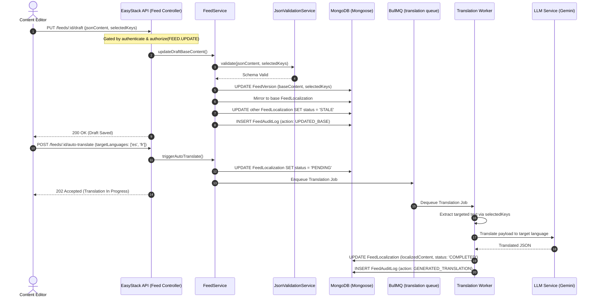

# Feed Localization Pipeline Workflow

## 1. Overview & Triggers

This workflow traces how structured JSON feeds are authored, validated against schema rules, marked stale when base content changes, and asynchronously translated into multiple target languages using AI workers.

### Triggers
- **Update Draft Content**: `PUT /api/projects/:projectId/feeds/:feedId/draft`
- **Trigger AI Auto-Translation**: `POST /api/projects/:projectId/feeds/:feedId/auto-translate`
- **Save Manual Translation**: `PUT /api/projects/:projectId/feeds/:feedId/translations/:lang`
- **Mark Stale as Correct**: `POST /api/projects/:projectId/feeds/:feedId/translations/:lang/mark-correct`

---

## 2. Sequence Diagram

---

## 3. Step-by-Step Execution Trace

### Phase 1: Authoring & Structural Validation
1. **Environment Check**: [`FeedService`](file:///home/eteknas/Projects/easystack-backend/src/services/feed.service.ts) verifies the target environment is editable (`targetEnv.isEditable === true`). Editing in non-editable environments throws `400 Bad Request`.
2. **Schema & JSON Validation**:
   - If the feed is linked to a Schema Blueprint, [`FeedSchemaValidationService`](file:///home/eteknas/Projects/easystack-backend/src/services/feed-schema-validation.service.ts) validates content types and required fields.
   - Otherwise, [`JsonValidationService`](file:///home/eteknas/Projects/easystack-backend/src/services/json-validation.service.ts) verifies max depth (<=10), array homogeneity, and wildcard path syntax.
3. **Draft Save & Stale Propagation**:
   - The JSON tree is saved into `FeedVersion.baseContent`.
   - The base language `FeedLocalization` is automatically updated to match.
   - All other existing translations are marked `status: 'STALE'` to warn frontend consumers that base text changes may have invalidated current translations.
   - An entry is appended to `FeedAuditLog` (`action: UPDATED_BASE`).

### Phase 2: AI Auto-Translation Pipeline
1. **Job Dispatch**: When auto-translation is invoked, `FeedLocalization` records are updated to `PENDING` and a batch job is enqueued in the `translation` BullMQ queue.
2. **Target Extraction**: The translation worker reads `FeedVersion.selectedKeys` and isolates only the string fields marked for translation using the `*` wildcard matcher.
3. **LLM Translation**: The worker formats a strict schema-preserving prompt for the LLM provider (`Gemini`).
4. **Completion & Audit**:
   - The LLM's response is validated for JSON shape preservation.
   - The translated content is written to `FeedLocalization.localizedContent` and status set to `COMPLETED`.
   - An audit event (`action: GENERATED_TRANSLATION`) is logged.
   - The aggregate feed status is recomputed.
