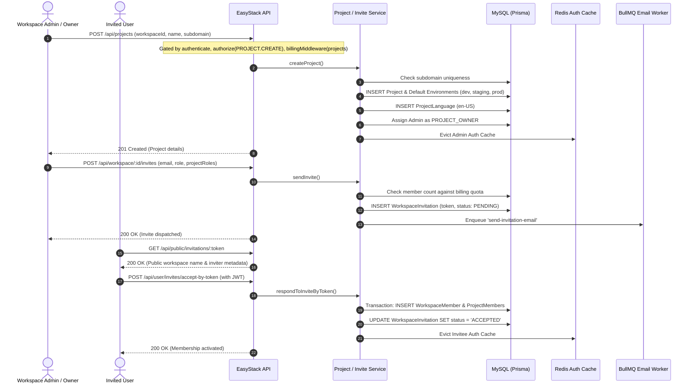

# Project Creation & Member Invitation Workflow

## 1. Overview & Triggers

This workflow covers the creation of scoped projects within workspaces, automated environment seeding, and the secure, privacy-preserving invitation and acceptance process.

### Triggers
- **Project Creation**: `POST /api/projects`
- **Workspace Member Invitation**: `POST /api/workspace/:workspaceId/invites`
- **Project Member Invitation**: `POST /api/projects/:projectId/invitations`
- **Public Invite Inspection**: `GET /api/public/invitations/:token`
- **Invite Acceptance**: `POST /api/user/invites/accept-by-token`

---

## 2. Sequence Diagram

---

## 3. Step-by-Step Execution Trace

### Phase 1: Project Creation
1. **Gatekeeping**:
   - `authenticate`: Validates JWT token.
   - `authorize`: Checks if caller has `PERMISSIONS.PROJECT.CREATE` on `workspaceId`.
   - `billingMiddleware`: Intercepts request to ensure workspace's active subscription allows creating another project, atomically consuming 1 unit of the `projects` quota.
2. **Subdomain Validation**: Verifies that the requested subdomain matches `/^[a-z0-9-]+$/` and is not already reserved in MySQL.
3. **Environment & Language Seeding**:
   - Creates project record in MySQL.
   - Automatically seeds 3 environments:
     - `development`: `isEditable: true` (direct editing permitted).
     - `staging`: `isEditable: false` (promotions via release only).
     - `production`: `isEditable: false` (promotions via release only).
   - Seeds `ProjectLanguage` with `en-US` as the default base language.
4. **Creator Assignment & Cache Eviction**:
   - Creator is inserted into `ProjectMember` as `PROJECT_OWNER`.
   - Evicts Redis key `authorization:v1:<adminUserId>` so new project permissions take immediate effect.

### Phase 2: Member Invitation & Acceptance
1. **Invitation Generation**:
   - Workspace admin specifies invitee email, workspace role, and optional project-level roles.
   - `billingMiddleware` verifies that adding a new member will not exceed the plan's `members` limit (`consume: false`).
   - Generates a cryptographically random invitation token. Writes record to `WorkspaceInvitation`.
   - Dispatches email invitation job to BullMQ `email` queue.
2. **Public Inspection**:
   - The invited user clicks link in email directing to `GET /api/public/invitations/:token`.
   - Public controller returns only display metadata (e.g., workspace name, inviting administrator name), completely hiding internal user IDs and database keys.
3. **Acceptance & Role Injection**:
   - User signs in or creates an account and submits `POST /api/user/invites/accept-by-token`.
   - Service executes an interactive Prisma transaction:
     - Adds user to `WorkspaceMember`.
     - Adds user to `ProjectMember` for each project role specified in the invite payload.
     - Sets invitation status to `ACCEPTED`.
   - Evicts `authorization:v1:<inviteeUserId>` from Redis. The next request compiles their newly inherited permissions.
