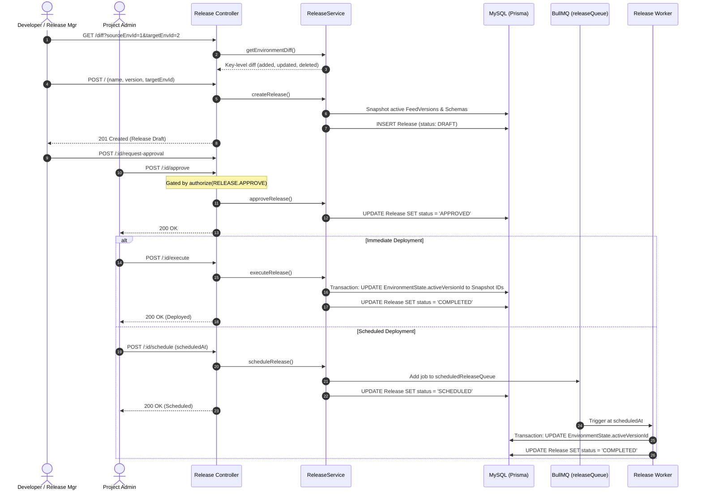

# Release Deployment Pipeline Workflow

## 1. Overview & Triggers

This workflow traces the promotion of feeds and schemas from editable development environments to read-only target environments (staging, production). It covers diff analysis, SemVer version suggestion, release creation with frozen snapshots, governance approval, scheduled or immediate deployment, and rollback.

### Triggers
- **Diff Inspection**: `GET /api/projects/:projectId/releases/diff`
- **SemVer Suggestion**: `GET /api/projects/:projectId/releases/suggest-version`
- **Create Release Draft**: `POST /api/projects/:projectId/releases`
- **Request Approval**: `POST /api/projects/:projectId/releases/:releaseId/request-approval`
- **Approve Release**: `POST /api/projects/:projectId/releases/:releaseId/approve`
- **Immediate Execution**: `POST /api/projects/:projectId/releases/:releaseId/execute`
- **Schedule Deployment**: `POST /api/projects/:projectId/releases/:releaseId/schedule`
- **Rollback Release**: `POST /api/projects/:projectId/releases/:releaseId/rollback`

---

## 2. Sequence Diagram



---

## 3. Step-by-Step Execution Trace

### Phase 1: Environment Diff & Version Suggestion
1. **Diff Calculation**: [`ReleaseService.getEnvironmentDiff()`](file:///home/eteknas/Projects/easystack-backend/src/services/release.service.ts) fetches the active `FeedVersion` documents from MongoDB for both the source environment and target environment. It compares JSON keys and content values, categorizing changes into `added`, `modified`, and `removed`.
2. **SemVer Recommendation**: Inspects whether schema changes occurred:
   - Structural key alterations or deletions -> Recommends `MINOR` or `MAJOR` bump.
   - Translation or content-only changes -> Recommends `PATCH` bump.

### Phase 2: Creation & Snapshot Freezing
1. **Freezing Snapshot**: Creating a release locks the exact state of all project feeds and schemas in the source environment.
2. **Relational Records**: In MySQL, a `Release` record is created with relations to `ReleaseFeed` and `ReleaseSchema`. These junction records store the exact MongoDB `versionId` strings at the moment of release creation.
3. **Immutability Guarantee**: Even if developers continue modifying the draft in the `development` environment, the release snapshot remains immutable.

### Phase 3: Deployment Execution
1. **Pointer Switch**: Deployment is performed within a Prisma transaction.
   - For every feed included in the release, the target environment's pointer in `EnvironmentState` is updated:
     ```typescript
     await tx.environmentState.upsert({
       where: { environmentId_feedId: { environmentId: targetEnv.id, feedId } },
       update: { activeVersionId: releaseFeed.versionId },
       create: { environmentId: targetEnv.id, feedId, activeVersionId: releaseFeed.versionId }
     });
     ```
2. **Instant Rollback**: If a deployment introduces a critical issue, `ReleaseService.rollbackRelease()` inspects the preceding completed release for that target environment and switches `activeVersionId` pointers back to the prior release's snapshots in a single atomic transaction.
