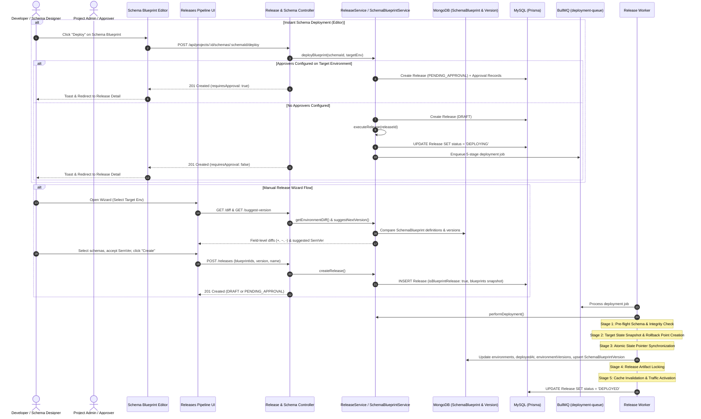

# Release Deployment Pipeline Workflow

## 1. Overview & Triggers

This workflow traces the promotion of Schema Blueprints from the lowest-rank editable environment to downstream target environments following strict rank-based promotion order: `rank[i] -> rank[i+1]`. Environment names are decoupled and configurable, defaulting to `development` (rank 10) and `production` (rank 20). It covers diff analysis, SemVer version suggestion, release creation with frozen snapshots, governance approval, scheduled or immediate deployment, instant deploy from schema blueprint editor, and atomic rollback.

### Triggers
- **Diff Inspection**: `GET /api/projects/:projectId/releases/diff?sourceEnvironmentId=:src&targetEnvironmentId=:tgt`
- **SemVer Suggestion**: `GET /api/projects/:projectId/releases/suggest-version?targetEnvironmentId=:tgt&feedIds=:ids`
- **Create Release Draft**: `POST /api/projects/:projectId/releases`
- **Instant Schema Deploy**: `POST /api/projects/:projectId/schemas/:schemaId/deploy`
- **Request Approval**: `POST /api/projects/:projectId/releases/:releaseId/request-approval`
- **Approve Release**: `POST /api/projects/:projectId/releases/:releaseId/approve`
- **Immediate Execution**: `POST /api/projects/:projectId/releases/:releaseId/execute`
- **Schedule Deployment**: `POST /api/projects/:projectId/releases/:releaseId/schedule`
- **Rollback Release**: `POST /api/projects/:projectId/releases/:releaseId/rollback`

---

## 2. Sequence Diagram

---

## 3. Step-by-Step Execution Trace

### Phase 1: Environment Diff & Version Suggestion
1. **Strict Rank-Based Promotion Path**: Releases can only transition to the immediate next environment in rank order (`targetIndex === sourceIndex + 1`). Deployments skipping ranks or targeting the initial authoring base environment are rejected with HTTP 400.
2. **Diff Calculation**: `ReleaseService.getEnvironmentDiff()` loads all `SchemaBlueprint` documents in MongoDB for the project. For each schema:
   - Evaluates source environment version definition against target environment version snapshot.
   - Categorizes schema status into `ADDED` (new schema on target), `MODIFIED` (existing schema with altered field definitions), or `REMOVED`.
   - Computes detailed field additions, modifications, and removals.
3. **SemVer Recommendation**:
   - Field removals or breaking alterations -> Recommends `MAJOR` bump.
   - Field additions or schema introductions -> Recommends `MINOR` bump.
   - Non-structural modifications -> Recommends `PATCH` bump.

### Phase 2: Creation & Snapshot Freezing
1. **Release Metadata**: `createRelease` stores `isBlueprintRelease: true`, `blueprintIds`, `blueprintNames`, and rich blueprint metadata (`id`, `name`, `slug`, `type`, `sourceVersionNumber`, `targetVersionNumber`) inside `deploymentProgress.blueprints`.
2. **Snapshot Immutability**: All blueprint states at creation time are captured in the release record. Even if authoring continues in the `development` environment, target deployment references remain frozen.

### Phase 3: Multi-Stage Deployment Execution
When executed directly or triggered via the Instant Schema Deploy workflow:
1. **Stage 1: Pre-flight Schema & Translation Integrity Check**:
   - Validates that all referenced Schema Blueprints exist and contain valid field schemas.
2. **Stage 2: Target Environment State Snapshot & Rollback Point Creation**:
   - Records preceding target environment versions for each schema to allow instant atomic rollbacks.
3. **Stage 3: Atomic State Pointer Synchronization**:
   - Loops through all blueprints in the release:
     - Updates MongoDB `SchemaBlueprint.environments` to include target environment ID.
     - Sets `SchemaBlueprint.deployedAt[targetEnvId] = new Date()`.
     - Updates `SchemaBlueprint.environmentVersions[targetEnvId] = sourceVer`.
     - Upserts `SchemaBlueprintVersion` record for target environment with `semanticVersion: release.version` and full `schemaDefinition`.
4. **Stage 4: Release Artifact Locking & Development Version Branching**:
   - Locks release version artifacts and increments development draft counters if applicable.
5. **Stage 5: Cache Invalidation & Traffic Activation**:
   - Invalidates Redis caches, marks `deploymentProgress.isComplete = true`, and sets `Release.status = 'DEPLOYED'`.

### Phase 4: Instant Rollback
If a regression is identified in the target environment:
1. `ReleaseService.rollbackRelease()` inspects the preceding completed release for that target environment.
2. Reverts `SchemaBlueprint.environmentVersions[targetEnvId]` to the previous version snapshot in an atomic transaction.
3. Sets `Release.status = 'ROLLED_BACK'`.
