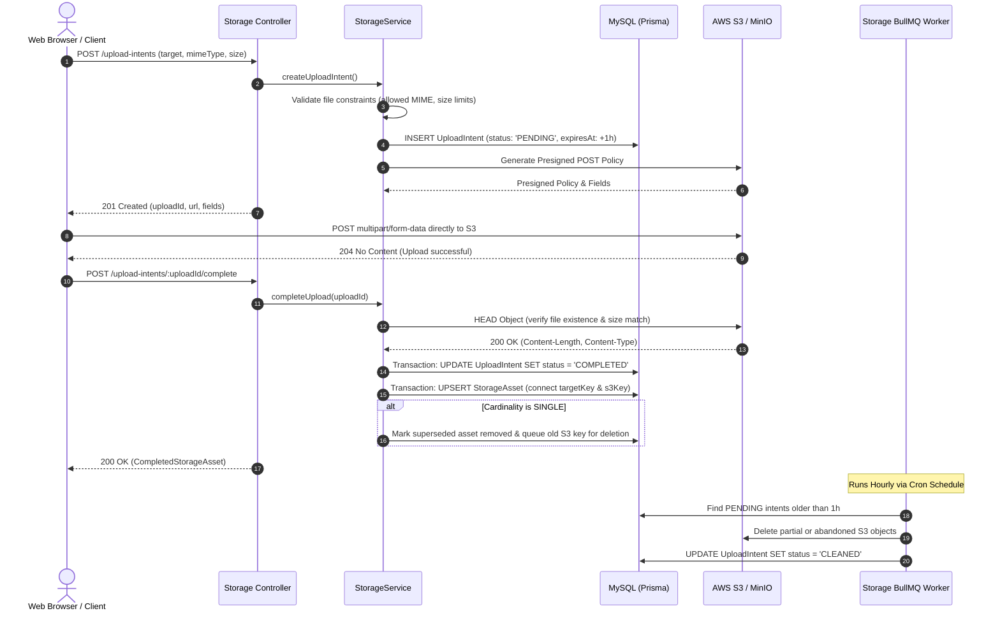

# Storage Upload Lifecycle Workflow

## 1. Overview & Triggers

This workflow traces the complete lifecycle of binary asset uploads: requesting upload intent, direct browser-to-S3 presigned POST upload, completion verification, asset registration, URL resolution, and automated garbage collection.

### Triggers
- **Request Upload Intent**: `POST /api/storage/upload-intents`
- **Complete Upload**: `POST /api/storage/upload-intents/:uploadId/complete`
- **Resolve Asset URLs**: `GET /api/storage/demo/assets` (or internal domain service calls)
- **Delete Asset**: `DELETE /api/storage/demo/assets/:assetId`
- **Hourly Reconciliation Cron**: Background job executing hourly
- **Daily Retention Purge Cron**: Background job executing daily at midnight

---

## 2. Sequence Diagram

---

## 3. Step-by-Step Execution Trace

### Phase 1: Upload Intent & Policy Generation
1. **Target & Constraint Verification**: [`DefaultStorageService.createUploadIntent()`](file:///home/eteknas/Projects/easystack-backend/src/services/storage/application/DefaultStorageService.ts) verifies that the requested MIME type is permitted for the slot (e.g., `image/png`, `image/jpeg` for logos) and the expected file size does not exceed the preset maximum (e.g., 5MB).
2. **Intent Registration**: Creates an `UploadIntent` record in MySQL with `status: 'PENDING'` and an expiration timestamp set to 1 hour from creation.
3. **Presigned S3 POST Generation**: Calls AWS SDK S3 request presigner to generate a presigned form POST policy. The policy strictly binds `bucket`, `key`, `content-length-range`, and `Content-Type`.

### Phase 2: Direct Client Upload & Verification
1. **Direct POST**: The client POSTs the binary file directly to AWS S3 / MinIO using the presigned fields. The API server process is never burdened with streaming binary file buffers.
2. **Completion & HEAD Verification**:
   - Client notifies the backend via `POST /api/storage/upload-intents/:uploadId/complete`.
   - [`DefaultStorageService.completeUpload()`](file:///home/eteknas/Projects/easystack-backend/src/services/storage/application/DefaultStorageService.ts) executes a `HEAD Object` call against S3.
   - It verifies that the object exists in S3, that its byte size matches the registered policy, and that its MIME type is valid.
3. **Asset Registration & Single-Slot Replacement**:
   - In a transaction, the intent is transitioned to `status: 'COMPLETED'`.
   - A `StorageAsset` record is created or updated.
   - If the slot cardinality is `SINGLE` (such as a project avatar), the previously active asset is marked removed, and its S3 key is scheduled for deletion.

### Phase 3: Garbage Collection & Retention
1. **Hourly Reconciliation**:
   [`storage.processor.ts`](file:///home/eteknas/Projects/easystack-backend/src/services/storage/infrastructure/queue/storage.processor.ts) scans for intents stuck in `PENDING` past their 1-hour expiration. If a partial file was uploaded to S3, it is deleted. The database record is updated to `status: 'CLEANED'`.
2. **Daily Retention Purge**:
   Runs once daily. Permanently deletes database intent records that have remained in `CLEANED` status for more than 30 days (`STORAGE_CLEANED_INTENT_RETENTION_DAYS`).
