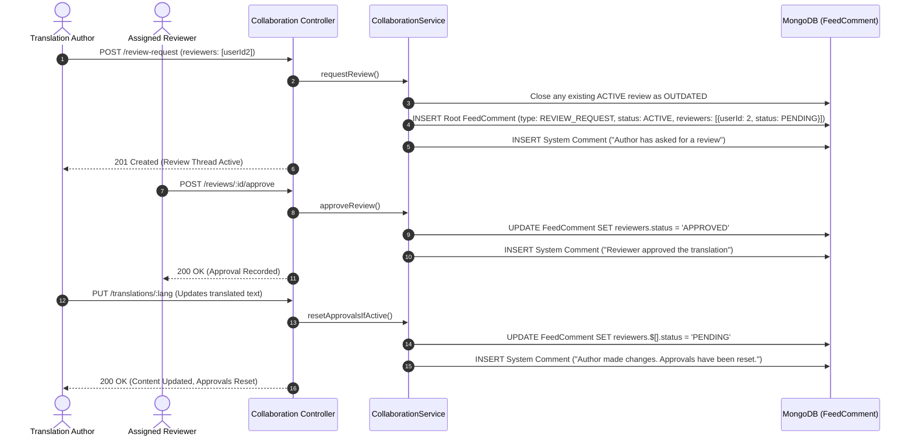

# Translation Review & Approval Reset Workflow

## 1. Overview & Triggers

This workflow traces the GitHub PR-style translation review lifecycle embedded directly into feed translation threads, including reviewer voting, automatic approval resets on text changes, and system comment generation.

### Triggers
- **Initiate Review Request**: `POST /api/projects/:projectId/feeds/:feedId/translations/:lang/review-request`
- **Submit Approval**: `POST /api/projects/:projectId/feeds/:feedId/translations/:lang/reviews/:reviewId/approve`
- **Add Reviewer**: `POST /api/projects/:projectId/feeds/:feedId/translations/:lang/reviews/:reviewId/reviewers`
- **Close Review**: `POST /api/projects/:projectId/feeds/:feedId/translations/:lang/reviews/:reviewId/close`
- **Text Modification (Reset)**: Triggered implicitly when base or translation text is edited while review is active.

---

## 2. Sequence Diagram



---

## 3. Step-by-Step Execution Trace

### Phase 1: Review Request Initiation
1. **Concurrency Check**: [`CollaborationService`](file:///home/eteknas/Projects/easystack-backend/src/services/collaboration.service.ts) verifies whether an active review already exists for this translation. To prevent competing threads, any existing `ACTIVE` review is transitioned to `status: 'OUTDATED'`.
2. **Thread Creation**: Inserts a root document into `FeedComment` with:
   - `type: 'REVIEW_REQUEST'`
   - `status: 'ACTIVE'`
   - `reviewers`: Array of assigned reviewer user IDs with initial `status: 'PENDING'`.
3. **Timeline Event**: Appends an initial system message to the comment thread: `"<Author Name> has asked for a review."`.

### Phase 2: Reviewer Voting & Thread Discussion
1. **Thread Replies**: Team members can post comments and replies directly into the review thread.
2. **Approval**: When an assigned reviewer approves:
   - The user's status within `FeedComment.reviewers` is updated to `'APPROVED'`.
   - A system comment is appended: `"<Reviewer Name> approved the translation."`.
   - If all required reviewers have approved, the translation can be finalized.

### Phase 3: The "Push Reset" Mechanic
1. **Change Detection**: When an author edits either the base English text or the foreign translation text, `CollaborationService.resetApprovalsIfActive()` is invoked.
2. **Atomic Reset**:
   - The backend runs an atomic update using MongoDB's positional operator:
     ```typescript
     await FeedComment.updateOne(
       { _id: activeReview._id },
       { $set: { "reviewers.$[].status": "PENDING" } }
     );
     ```
   - This ensures all previously approved reviewers are immediately reverted to `PENDING`.
3. **Notification Message**: A system comment is automatically appended to the timeline:
   `"<Author Name> made changes to the translation. Approvals have been reset."`
